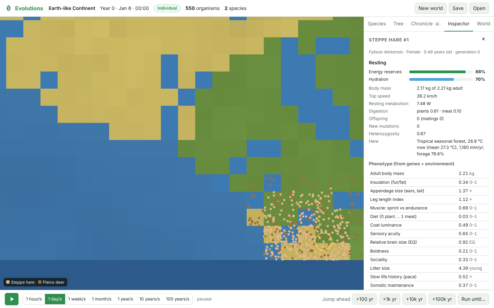
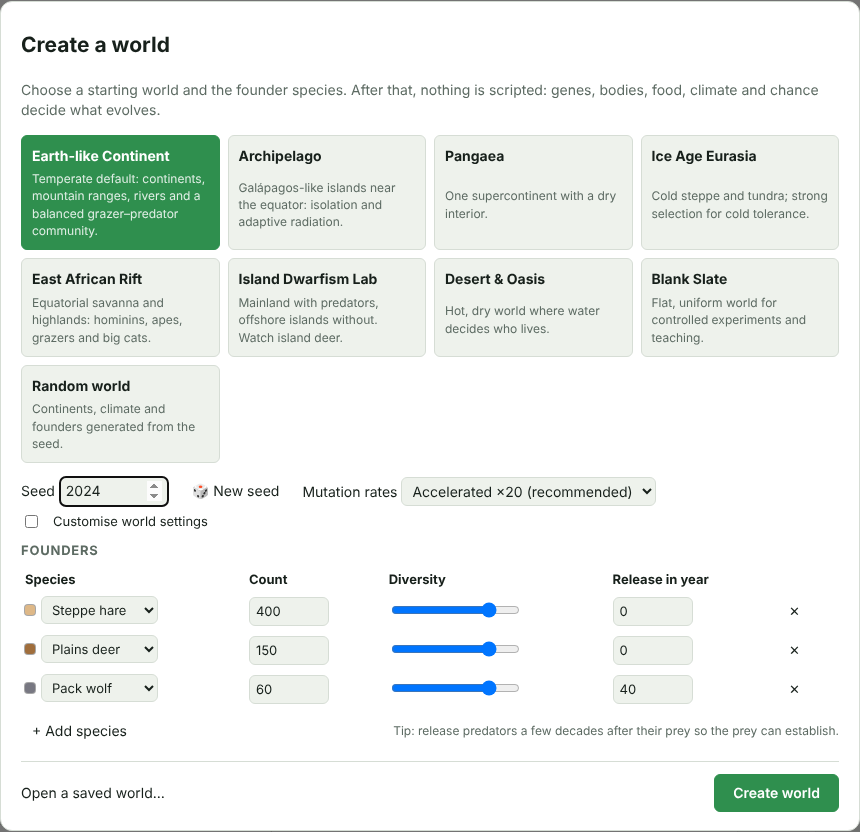
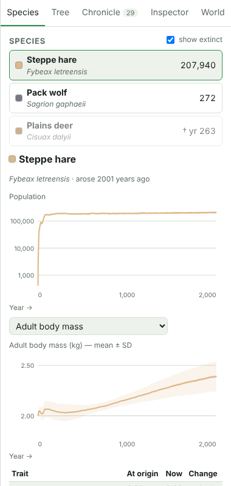
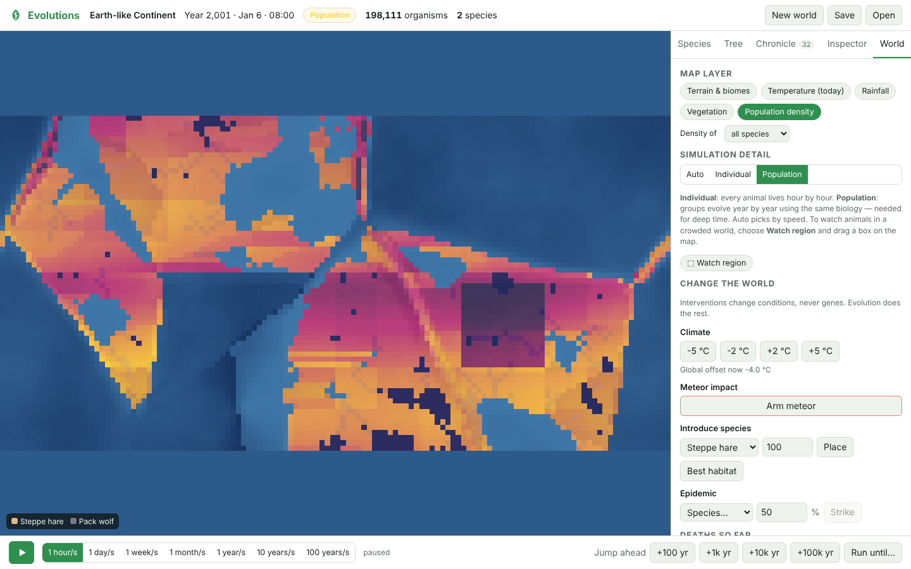
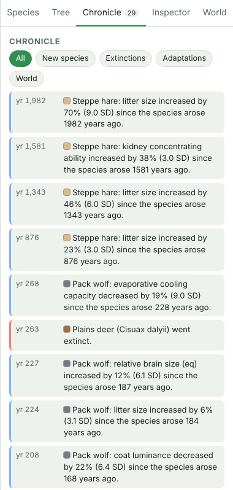

# Evolutions

A realistic simulation of biological evolution. Build a world (random, from a template, or your own settings), release animals and early humans, and watch them eat, drink, hunt, flee, court, breed, age and die. Fast-forward through deep time to see what the forces of real evolution make of them: natural and sexual selection, genetic drift, mutation, gene flow and speciation.

Nothing is scripted. Thick fur in the cold, thin coats in the desert, island populations becoming new species, predators wiping out scarce prey: all of these emerge from genes, bodies, food, climate and chance.

- **User guide:** [every feature, step by step, with screenshots](docs/USER_GUIDE.md)
- **Design documents:** [PRD](docs/PRD.md) · [TRD](docs/TRD.md) · [System Design](docs/SYSTEM_DESIGN.md) · [Improvement plan](docs/IMPROVEMENT_PLAN.md) (audits, fixes and what's next)
- **Engine:** Rust (`engine/`). Headless CLI, scientific validation suite, and WebAssembly build.
- **App:** browser UI (`app/web/`). React and TypeScript; the engine runs in a Web Worker.



## Screenshots

| | |
|---|---|
|  |  |
| **Create a world.** Pick a template or a random world, then choose founder species, counts, diversity and release year. | **Species.** Population and trait trends over time; extinct species stay listed. |
|  |  |
| **World.** Map layers (here, population density after a meteor strike) and interventions: climate shifts, meteors, introductions, epidemics. | **Chronicle.** What happened and when: new species, extinctions, crashes and significant trait changes. |

Screenshots come from the [user guide](docs/USER_GUIDE.md), which walks through every feature. Regenerate them with `npm run build && npm run screenshots` in `app/web/`.

## Where to use it, and why

Evolution is hard to see. It happens over thousands of generations, and its outcome depends on many interacting forces. Evolutions lets you watch that process directly, rerun it with a different seed, and change one condition at a time.

| Where | Use it to | Why it helps |
|---|---|---|
| **Classrooms and lectures** (school biology, university evolution and ecology courses) | Show natural selection, drift, speciation and predator–prey cycles live; set exercises such as "release hares on the Ice Age map and explain what happens to their fur" | Students see adaptation emerge from cause and effect rather than reading about it. Templates like *Island Dwarfism Lab* and *Blank Slate* are built for set experiments, and the same seed lets a whole class reproduce one run. |
| **Self-study and curiosity** | Ask "what if?": warmer climate, a meteor, wolves introduced to an island | Every outcome comes from genes, bodies, food, climate and chance. The Inspector shows each animal's state, the Chronicle records what changed, and the CLI's `--debug` shows why a population grows or declines. |
| **Research and teaching labs** | Run the headless CLI for many seeds, export CSV time series and Newick trees, and analyse them in R or Python | Quick intuition-building for population-genetics and eco-evolutionary questions. The validation suite checks the engine against Hardy–Weinberg, Kimura fixation, the breeder's equation and other textbook results. |
| **Museums, outreach and science communication** | Run *Earth-like Continent* or *East African Rift* on a screen and fast-forward through deep time | Nothing is scripted, so each run tells a different but plausible story. |
| **Game and simulation developers** | Study or reuse the engine: utility-AI behaviour, physiology models, Individual ↔ Population switching | A worked example of scaling an agent-based simulation from one animal per hour to whole populations over 100,000 years. |

It is not a forecasting tool. Absolute numbers are scaled down and mutation rates are accelerated by default (see *Modelling notes* below), so use it to understand mechanisms and trends, not to predict real populations.

## Quick start

### Browser app

Requirements: Rust (stable) with the `wasm32-unknown-unknown` target, `wasm-bindgen-cli` 0.2.129, and Node 20+.

```bash
rustup target add wasm32-unknown-unknown
cargo install wasm-bindgen-cli --version 0.2.129
cd app/web
npm install
npm run build:wasm    # compile the engine to WebAssembly
npm run dev           # open the printed URL
```

In the app:
- Pick a template (or **Random world**), adjust the founder species, and press **Create world**. Tick **Customise world settings** to change size, land, climate and seasons.
- Press **Space** or ▶ to run time.
- Click an animal to inspect it. Scroll to zoom, drag to pan.
- **Jump ahead** (+100 to +100k years) fast-forwards in Population mode.
- **Run until…** fast-forwards until a new species arises, a species goes extinct, or a population or trait crosses a threshold.
- In a crowded world, **shift-drag** a box on the map (or use **Watch region**) to watch that area animal by animal.
- The **World** tab has map layers and interventions (climate shift, meteor, introduced species, epidemic).
- **Save** and **Open** store whole worlds in `.evo` files. The current world is also autosaved in the browser, and the start dialog offers to resume it.

### Headless CLI

```bash
cd engine
cargo run --release -p evo-cli -- list                       # templates and species
cargo run --release -p evo-cli -- run --template ice_age --seed 7 --years 2000 \
    --csv out/ --newick out/tree.nwk --out out/run.evo
cargo run --release -p evo-cli -- info out/run.evo
```

`--debug` prints each species' yearly vital rates (starvation, predation, heat and cold hazards; food ratio; fecundity), which is useful for understanding *why* a population grows or declines.

## What is simulated

| Area | Model (details in the TRD) |
|---|---|
| World | Plate-like terrain, lapse-rate and latitude climate, seasons from axial tilt, moisture advection with rain shadows, rivers and lakes, Whittaker biomes, Miami-model productivity with high-quality and coarse forage |
| Genetics | Diploid genomes with 8 mapped chromosomes and ~170 loci; meiosis with crossing over; mutation (continuum-of-alleles); dominance; pleiotropy; neutral markers; Dobzhansky–Muller incompatibility loci |
| Traits | 21 heritable traits: body mass, insulation, appendages, legs, muscle type, diet, coat colour, senses, brain size, behaviour, litter size, pace of life, maintenance, ornaments and preferences, breeding season, dispersal, kidney, heat tolerance |
| Physiology | Kleiber metabolism, thermal conductance, behavioural thermoregulation, water balance, West ontogenetic growth, Gompertz–Makeham ageing, Taylor locomotion costs, Hirt top speed, expensive-tissue brain cost, size-dependent fibre digestion (Jarman–Bell) |
| Behaviour (Individual mode) | Utility AI with heritable weights: forage, drink, hunt, scavenge, flee, rest, seek mates (with mate choice), nurse, follow mother, herd, disperse |
| Ecology | Grazing and plant regrowth, predation (analytic chases in Individual mode; ratio-dependent type III response with satiation, prey refuges and scavenging in Population mode), competition, carrion |
| Evolution at scale (Population mode) | Age- and sex-structured demes per 8×8-tile patch; selection gradients from the same physiology functions; Wright–Fisher drift; mutation; migration along land borders, plus rare rafting |
| Species | Automatic detection by reproductive compatibility (biological species concept), with hysteresis; allopatric vs parapatric/sympatric cause; generated binomial names; phylogeny with Newick export |
| Time | Individual mode (1-hour ticks) ↔ Population mode (1-year steps), switched automatically by speed; focus regions; deterministic replay; save/load |

## Validation

`cargo test --release` (in `engine/`) runs the fast scientific suite on every change:

| Test | Checks |
|---|---|
| V-G1 Hardy–Weinberg | Genotype frequencies after random mating fit p², 2pq, q² |
| V-G2 Neutral fixation | A new neutral allele fixes with probability ≈ 1/(2N) |
| V-G3 Drift | Heterozygosity decays as H₀(1 − 1/2N)ᵗ |
| V-G4 Kimura | A beneficial allele fixes with probability (1 − e^−2s)/(1 − e^−4Ns) |
| V-G5 Breeder's equation | Response to truncation selection ≈ h²·S |
| V-G6 Haldane | Recombination fraction matches Haldane's map function |
| Determinism, save/load | Same seed gives the same history; a reloaded world continues identically |
| V-P1 Transitions | Individual ↔ Population switches conserve abundance, mean genetic values and diversity |

`cargo test --release -- --ignored` also runs the long ecological tests:
- **V-B1 cold-adaptation cline:** from the same founders, northern hares evolve thicker insulation than southern ones; this holds in 5/5 seeds.
- **V-S1 allopatric speciation:** populations separated by straits accumulate incompatibilities and are detected as separate species.

The browser app has an end-to-end smoke test: `npm run build && npm run test:e2e`.

## Implementation status (v0.1)

This version implements the must-have scope of the PRD, plus several later items. Where it differs from the design documents:

| Design document says | v0.1 does | Why / next step |
|---|---|---|
| Three fidelity modes (Individual, Population, Macro) | Individual and Population only | Macro mode (species-level, 1,000-year steps) is the next milestone. Population mode runs at about 30–70 simulated years per second natively (single-threaded, depending on world size; somewhat slower in the browser), so tens of thousands of years take minutes. |
| 15-minute ticks; ≥ 100,000 animals on 8 cores | 1-hour ticks; single-threaded; about 0.2 µs per animal per tick; cap of 25,000 individuals (larger worlds use focus regions) | Parallel systems (rayon) are planned for native builds. |
| ECS (`bevy_ecs`), FlatBuffers, SQLite saves, Tauri desktop shell | Plain Rust structs; JSON plus typed arrays between worker and UI; bincode `.evo` saves; browser app only | These keep the MVP small. The engine API is ready to be wrapped by a desktop shell. |
| Hominin traits (bipedalism, culture, pigmentation) | Hominins and apes use the general trait set (brain size, sociality, sweating, diet …) | Cultural evolution and hominin-specific traits are planned (PRD §7.5, P1). |
| Disease with pathogen genomes | Epidemics as an intervention only | Planned (P1). |
| "Why?" explanations | Per-deme vital-rate diagnostics (CLI `--debug`, WASM `diagnostics()`) | Plain-language explanations in the UI are planned. |

**Modelling notes**
- **Population scale:** a tile is tens to hundreds of kilometres wide for climate, while `habitat_m2_per_tile` sets how many animals it supports. Absolute numbers are scaled down; ratios and dynamics are what matter.
- **Mutation rates:** the default *Accelerated* setting multiplies literature mutation rates by 20 and is always shown in the UI. *Strict* uses literature rates.
- **Population mode:** to bound cost, each deme tracks at most one new allele per locus and a capped number of new mutations per year. In large demes almost all untracked mutations would be lost to drift anyway.
- **Predators are fragile, as they are in nature.** Whether they persist depends on prey energy and on the world. In the Earth template wolves usually coexist with hares and deer, sometimes driving deer extinct through apparent competition. In harsher templates they often die out.
- **Speciation is slow at realistic population sizes.** It is fastest in small isolated populations, such as islands.

## Repository layout

```text
docs/                  PRD, TRD, System Design
engine/
  evo-engine/          simulation library (world, genetics, physiology, individual & population modes, species, API)
  evo-engine/tests/    scientific validation suite
  evo-cli/             headless runner (`evo`)
  evo-wasm/            WebAssembly bindings
app/web/               browser app (React + Vite), engine worker, e2e smoke test
```

## License

MIT
