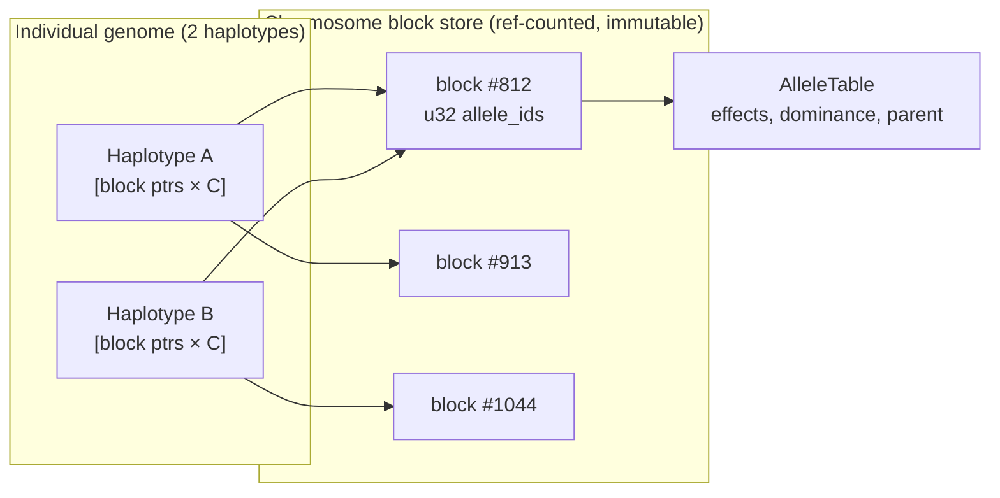
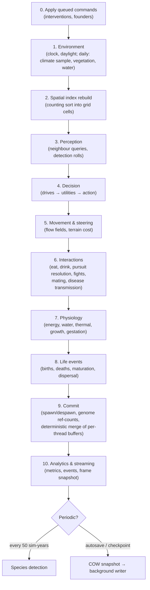
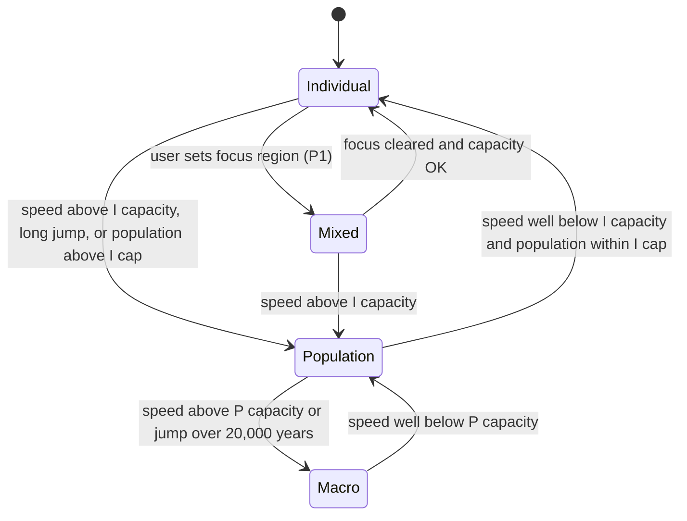
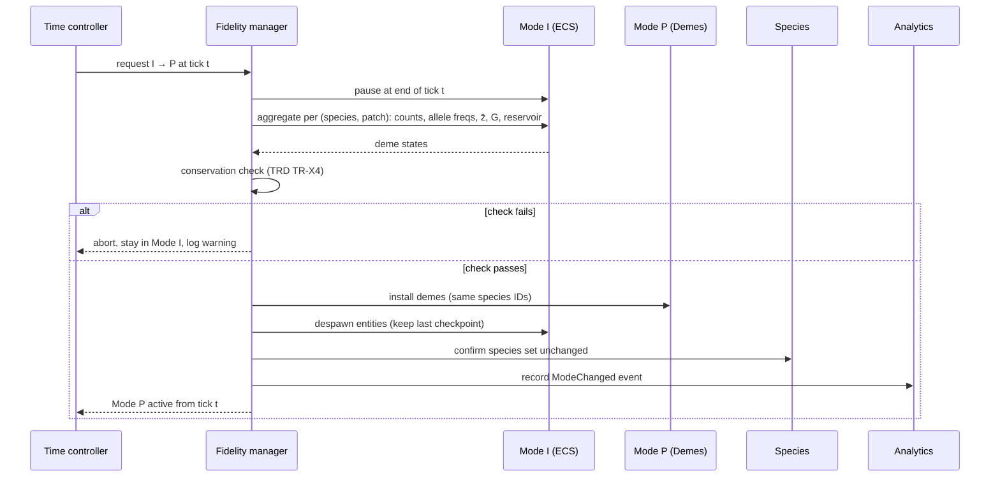
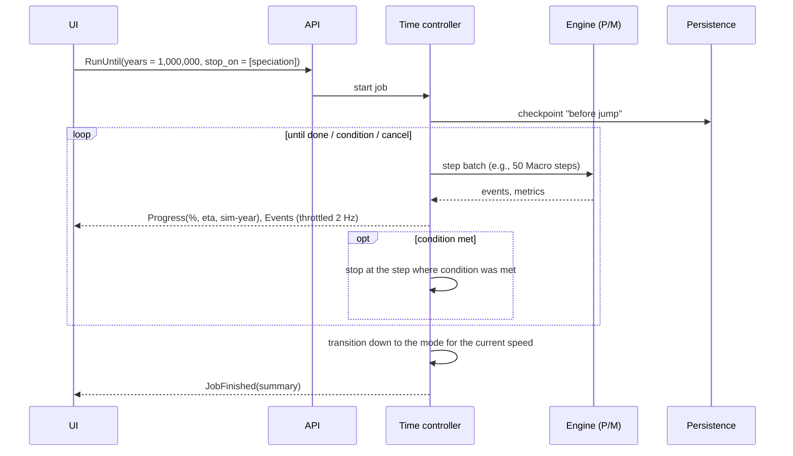
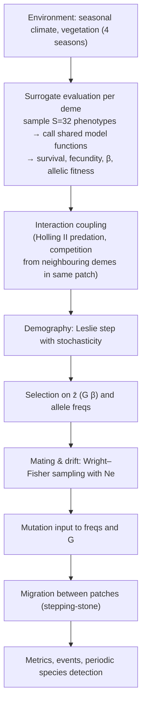
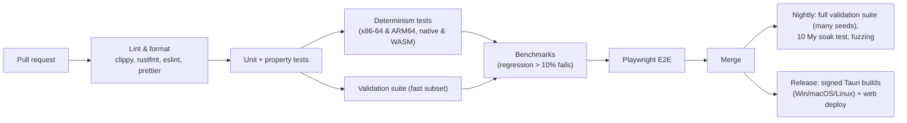

# Evolutions — System Design

| Field | Value |
|---|---|
| Document | System Design |
| Product | Evolutions |
| Version | 0.1 (Draft) |
| Date | 2026-10-15 |
| Status | Proposed |
| Related | [PRD](./PRD.md) · [TRD](./TRD.md) |

---

## 1. Overview

This document describes **how** Evolutions is built: processes, components, data structures, the simulation loop, the multi-fidelity time system, the engine–UI protocol, persistence, and the main runtime flows. Requirements and scientific models are specified in the [PRD](./PRD.md) and [TRD](./TRD.md); this document refers to them by ID.

### 1.1 Design goals

1. **Correct science, emergent outcomes:** each biological mechanism is a separate, testable system. No system encodes an evolutionary outcome.
2. **Deep time:** three fidelity modes (Individual, Population, Macro) behind a single time controller, with conservative, tested transitions.
3. **Deterministic:** same inputs → same history, regardless of thread count.
4. **Headless-first engine:** the UI is one client of a message API; tests and the CLI are others.
5. **Responsive UI:** the simulation never blocks rendering or input.

### 1.2 Architecture at a glance

```mermaid
flowchart LR
    subgraph Client["Client (Tauri webview / Browser)"]
        UI["React UI<br/>panels, editors, charts"]
        R["Renderer<br/>three.js / WebGL2 map"]
        PC["Protocol client<br/>FlatBuffers"]
        UI <--> PC
        R <--> PC
    end

    subgraph Host["Engine host (native sidecar process / Web Worker)"]
        API["API & Session manager"]
        TC["Time controller<br/>+ Fidelity manager"]
        subgraph Core["Simulation core"]
            ENV["World & Environment<br/>terrain, climate, hydrology, vegetation"]
            IND["Mode I: Organism systems<br/>(ECS)"]
            POP["Mode P: Deme engine"]
            MAC["Mode M: Lineage engine"]
            GEN["Genetics<br/>allele table, meiosis, mutation"]
            SPC["Species & Phylogeny"]
        end
        AN["Analytics<br/>metrics, chronicle, explain"]
        PS["Persistence<br/>checkpoints, saves"]
    end

    DB[("Save file<br/>SQLite .evo")]

    PC <-- "commands / queries<br/>snapshots / events" --> API
    API --> TC
    TC --> Core
    Core --> AN
    Core --> PS
    AN --> PS
    PS <--> DB
```



**Desktop:** the Tauri shell starts the engine as a native sidecar process and connects through a local socket (Unix domain socket / named pipe). Large frame snapshots are written into a shared-memory ring buffer; the socket carries small control messages.
**Web:** the engine is compiled to WASM with threads and runs in a dedicated Web Worker; snapshots use a `SharedArrayBuffer` ring buffer and control messages use `postMessage`.

## 2. Codebase structure

```text
evolutions/
├── docs/                         # PRD, TRD, System Design, ADRs
├── schema/                       # FlatBuffers schemas (API), JSON Schemas (templates)
├── params/                       # Versioned model parameter sets (TOML) with citations
├── templates/                    # World & species templates
├── engine/                       # Rust Cargo workspace
│   ├── evo-core/                 # time, ids, RNG, math, parameter registry, event bus
│   ├── evo-world/                # terrain gen, hydrology, climate, vegetation fields
│   ├── evo-genetics/             # genome architecture, allele table, meiosis, mutation, G→P
│   ├── evo-organism/             # ECS components & systems: physiology, behaviour, reproduction
│   ├── evo-ecology/              # predation resolution, carcasses, disease, nutrient cycling
│   ├── evo-population/           # Mode P: demes, Leslie matrices, Wright–Fisher, surrogate eval
│   ├── evo-macro/                # Mode M: lineages, OU evolution, speciation/extinction hazards
│   ├── evo-fidelity/             # mode selection, I↔P↔M transitions, regional fidelity
│   ├── evo-species/              # species detection, phylogeny, naming
│   ├── evo-analytics/            # metric recorder, chronicle, "why?" explanations
│   ├── evo-persist/              # SQLite save container, checkpoints, migrations
│   ├── evo-api/                  # message handling, sessions, snapshot streaming
│   ├── evo-sidecar/              # native host binary
│   ├── evo-wasm/                 # WASM host bindings
│   ├── evo-cli/                  # headless CLI (batch runs, exports)
│   └── evo-validation/           # scientific validation suite (TRD §9)
└── app/                          # pnpm workspace
    ├── shell/                    # Tauri app
    ├── web/                      # browser entry
    ├── ui/                       # React components, state store
    ├── renderer/                 # map & 3D renderer, creature mesh generator
    ├── charts/                   # time-series, phylogeny, histograms
    └── protocol/                 # generated FlatBuffers TS bindings + client
```

Dependency rule: crates depend "downward" only (`evo-core` ← `evo-genetics` ← `evo-organism` ← …). Mode engines (`evo-organism`, `evo-population`, `evo-macro`) do not depend on each other; only `evo-fidelity` knows about all three. Shared biology (physiology formulas, fitness components) lives in `evo-organism::model` as **pure functions** so Mode P's surrogate evaluation calls exactly the same code as Mode I (TRD TR-MP2).

## 3. Data model

### 3.1 Global resources (engine-wide, one instance per world)

| Resource | Description |
|---|---|
| `SimClock` | current tick (sim-minutes, `u64`), calendar, current mode, speed |
| `WorldParams` | seed, size, physical constants, realism dial, parameter-set hash |
| `ParamRegistry` | all model parameters, loaded from `params/*.toml` |
| `RngKey` | world seed; RNG derived as `philox(seed, tick, entity, stream)` |
| `IdAllocator` | monotonic `u64` entity IDs (TRD TR-D5) |
| `AlleleTable` | append-only table of all alleles (TRD TR-G2) |
| `GenomeArch` | per-lineage genome architecture (chromosomes, loci, map positions, trait mapping, **M** matrix) |
| `SpeciesRegistry` | species, their lineage arch, names, status |
| `Phylogeny` | species tree (nodes, split/extinction times, causes) |
| `EnvGrids` | chunked environment fields (see §3.4) |
| `SpatialIndex` | uniform-grid hash of entity positions for neighbour queries |
| `FlowFields` | cached navigation fields (water, refuge) per region |
| `EventBus` | per-tick structured events (births, deaths, fights, speciation …) |
| `MetricBuffer` | per-tick/per-step aggregates for analytics |

### 3.2 Mode I entities (ECS components)

Components are stored column-wise (SoA) by `bevy_ecs` archetypes. Hot components are small and plain-old-data.

| Component | Fields (abridged) | Hot? |
|---|---|---|
| `Transform` | `pos: Vec2 (f32, metres)`, `heading: f32`, `vel: Vec2` | ✔ |
| `SpeciesTag` | `species_id: u32`, `lineage_id: u32` | ✔ |
| `Genome` | `handle: GenomeHandle` (index into genome store, see §3.3) | |
| `Phenotype` | packed `[f32; N_TRAITS]` (developed traits), recomputed on growth stages | ✔ |
| `Body` | `mass_structural`, `fat`, `water`, `temperature`, `age_ticks`, `sex`, `life_stage` | ✔ |
| `Drives` | `hunger, thirst, fatigue, fear, thermal, libido, parental` (`f32`) | ✔ |
| `Action` | current action enum, target entity/position, started tick | ✔ |
| `Memory` | ≤ 16 spatial/learned entries (fixed array) | |
| `Health` | injuries, infections (small vec of pathogen IDs + state), immunity state | |
| `Reproduction` | oestrus state, pregnancy (`father_id`, embryo genomes, due tick), offspring list | |
| `Social` | `group_id`, rank, mate bond, parent IDs | |
| `Culture` (hominins) | bitset of known cultural traits + proficiency | |
| `Lineage` | `mother_id`, `father_id`, `birth_tick`, generation number | |
| `Carcass` (on corpses) | energy remaining, decay rate | |
| `Pathogen` (pathogen strains) | antigen alleles, virulence, transmissibility | |

### 3.3 Genome storage



- A haplotype is an array of `C` pointers to immutable **chromosome blocks** (arrays of `u32` allele IDs).
- Meiosis creates a new block only for chromosomes where a crossover occurred or a mutation happened; otherwise the parent's block is shared (ref-count increment). Since most chromosome copies are inherited unchanged, this keeps memory low (TRD TR-G11).
- Blocks live in a slab allocator with free lists; ref-counts are updated in a deterministic, single-threaded "commit" phase at the end of the tick.
- **Genetic values are cached**: each genome keeps `G` (genetic values per trait) computed at conception, because genotype→genetic value is the most expensive genetic step and genotypes never change during life.
- The `AlleleTable` is append-only; alleles extinct for > N checkpoints are compacted into a cold archive (kept for allele genealogy queries).

### 3.4 Environment grids

- Fields stored as **chunked SoA grids** (64 × 64 tiles per chunk, `f32` or `u16` quantised): `elevation`, `water_depth`, `river_flow`, `temp_month[12]` baseline, `precip_month[12]` baseline, `biome`, `veg_biomass[types]`, `veg_quality`, `fertility`, `uv_index`, `snow`, `fire_state`, `occupancy[species]` (rolling density).
- Static fields (elevation, baselines) are separated from dynamic fields to make checkpoints smaller (static fields are stored once per world or per tectonic epoch).
- Vegetation updates run per chunk in parallel, once per **sim-day** in Mode I (not per tick) and once per season in Mode P.

### 3.5 Mode P and Mode M structures

```text
struct Deme {                       // one species in one habitat patch (8×8 tiles)
    species: SpeciesId,
    patch: PatchId,
    abundance: [[u32; N_AGE]; 2],   // age class × sex
    allele_freq: SparseFreqTable,   // per locus: (allele_id, freq) sorted, + "other"
    zbar: TraitVec,                 // additive genetic mean
    g_matrix: SymMatrix<N_TRAITS>,  // additive genetic (co)variance
    condition_mean: f32,
    reservoir: ArrayVec<Haplotype, 64>,
    ne: f32,
}

struct Lineage {                    // Mode M unit
    species: SpeciesId,
    range: CoarseMask,              // 1/8 resolution tile mask
    abundance: f64,
    zbar: TraitVec,
    g_matrix: SymMatrix<N_TRAITS>,
    neutral_div: Vec<(LineageId, f32)>,
    dmi_count: Vec<(LineageId, u32)>,
    niche_cache_key: EnvClassId,
}
```

## 4. Simulation loop (Mode I)

### 4.1 Tick pipeline

Each tick (Δt = 15 sim-minutes) runs a fixed sequence of **stages**. Systems inside a stage run in parallel where they touch disjoint components; across stages there is a barrier.



**Conflict resolution in stage 6.** Interactions that touch two entities (predator eats prey, two animals want the same carcass, mating) are expressed as **intents** written to per-thread buffers. A single deterministic resolver sorts intents by `(target_id, priority, actor_id)` and applies them, so the result is independent of thread scheduling (TRD TR-D4).

### 4.2 Spatial index and perception

- Uniform grid with cell size ≈ the median perception radius (default 200 m); rebuilt every tick by counting sort (O(n), cache-friendly).
- Perception queries iterate the 3×3 (or 5×5 for long-range senses) neighbourhood and apply detection probabilities (TRD TR-BH2). Results are capped at the K = 8 most salient stimuli per individual.
- Animals that are resting in a safe state with no nearby stimuli are put on a **sleep schedule** (re-evaluated every N ticks) to save CPU — a large saving since many animals rest at night.

### 4.3 Per-tick time budget (100,000 individuals, 8 cores, target 4 ms)

| Stage | Budget |
|---|---|
| Commands, environment (amortised daily work) | 0.2 ms |
| Spatial index | 0.3 ms |
| Perception | 1.2 ms |
| Decision | 0.6 ms |
| Movement | 0.4 ms |
| Interactions + resolver | 0.5 ms |
| Physiology | 0.4 ms |
| Life events + commit (incl. meiosis for births) | 0.2 ms |
| Analytics + snapshot | 0.2 ms |
| **Total** | **4.0 ms** (≈ 250 ticks/s) |

## 5. Time controller and fidelity manager

### 5.1 Responsibilities

- Turn the user's requested speed (sim-seconds per real second) into a schedule of engine steps per frame.
- Pick the fidelity mode, with hysteresis, or honour a mode lock (TRD TR-T3).
- Run **jobs**: "advance N years", "run until condition", with progress and cancellation.
- Keep the UI informed (`ModeChanged`, `Progress`, `ClockUpdate`).

### 5.2 Mode state machine



Thresholds use hysteresis: switch up when the requested speed exceeds 90% of the current mode's capacity for 3 s (or a jump exceeds 50 years for I → P, 20,000 years for P → M); switch down when it falls below 60% for 3 s.

"Capacity" is measured continuously (moving average of achieved sim-time per real second in each mode) rather than assumed, so a small world stays in Individual mode at higher speeds than a large one.

### 5.3 Transition procedure



Materialising (P → I) runs the reverse, followed by a hidden warm-up of ≤ 1 sim-day where individuals form groups and pair bonds and pick initial actions; metrics are not recorded during warm-up.

**Mixed mode (P1).** The focus region's patches are materialised; every P-step (1 sim-year), boundary exchange takes the individuals that left the focus region (folded into the neighbouring deme counts and allele frequencies) and the expected immigrants from neighbouring demes (materialised by sampling from those demes). Mode I ticks inside the region run at the I-mode schedule; the outside world advances one P-step each time the focus region completes a sim-year.

### 5.4 Long jobs ("Jump to future")



The job runs on the engine's worker pool; the API thread stays free to answer queries and `Cancel`. On cancel, the engine stops at the next step boundary (state is always consistent between steps).

## 6. Mode P and Mode M engines

### 6.1 Mode P step (1 sim-year)



- Demes are processed in parallel by patch; interactions within a patch read the previous step's state (double-buffered), so the order between patches doesn't matter.
- **Surrogate cache:** vital-rate results are cached by `(species, quantised phenotype distribution, environment class, density class)` and reused across demes and years, typically a > 80% hit rate in stable climates.

### 6.2 Mode M step (1,000 sim-years)

- Update global climate (orbital forcing) and sea level → recompute habitat masks for affected lineages.
- Split lineages whose ranges became disconnected; merge (secondary contact) if compatibility ≥ τ.
- For each lineage: look up the trait optimum θ for its environment class (cache; on miss, run optimisation against the Mode P fitness model in a background task and use the previous θ until it's ready); OU update; abundance update (logistic + environmental noise + community LV coupling); speciation/extinction hazards.
- Record phylogeny changes and metrics at 10 ky resolution.

## 7. Engine–UI communication

### 7.1 Channels

| Channel | Transport (desktop / web) | Content |
|---|---|---|
| Control | Local socket / `postMessage` | Commands, queries, replies (FlatBuffers, correlation IDs) |
| Frame stream | Shared-memory ring buffer / `SharedArrayBuffer` | `FrameSnapshot` at ≤ 60 Hz: entities in the viewport |
| Event stream | Control channel, batched | Chronicle events, mode changes, warnings |
| Bulk queries | Control channel, chunked | Map layers, metric series, phylogeny |

### 7.2 Frame snapshots

- Only entities inside the viewport (+10% margin) are sent, in a compact struct: `id u64, pos f32×2, heading u8, species u16, appearance_id u32, action u8, flags u8` (≈ 24 bytes). 20,000 visible entities ≈ 480 KB/frame.
- At low zoom, the engine sends **density tiles** (per-species counts per tile) instead of individuals.
- In Mode P/M, frames contain deme/lineage aggregates; the renderer shows herds as "impostor" crowds sampled from density, clearly marked as approximate.
- **Back-pressure:** the ring buffer holds 3 frames; if the UI falls behind, the engine overwrites the oldest frame (the simulation never waits for the renderer).

### 7.3 Client state

- UI state store (Zustand or Redux Toolkit) keeps only view state and cached query results; the engine is the single source of truth.
- Charts request downsampled series matching their pixel width (`GetMetrics(resolution)`).

## 8. Rendering

- **2D map (P0):** WebGL2 tile renderer with shader-based layers (terrain hillshade, biome, temperature, rainfall, vegetation, density, allele-frequency heatmap). Entities drawn as instanced sprites coloured by species or by a selected trait.
- **3D view (P1):** three.js terrain mesh with chunked LOD; creatures as instanced skinned meshes.
- **Procedural appearance:** a deterministic `appearance_id` is computed from phenotype buckets (mass, limb index, appendage size, coat hue/luminance/pattern, ornament, dentition, locomotion). The client's creature generator builds and caches a mesh/texture per `appearance_id` from a parametric body template (spine, limbs, head, tail, ears). Visual changes are therefore driven by real trait values.
- Animation states map from `action` (walk, run, eat, drink, sleep, fight, mate, nurse).

## 9. Persistence and checkpoints

### 9.1 Copy-on-write snapshots

1. At a tick boundary the engine takes a **logical snapshot**: ECS columns, env dynamic chunks and Mode P/M tables are cloned by reference (chunked, `Arc`-backed buffers). Chunks modified later are copied on write.
2. The snapshot is handed to the **background writer** thread, which compresses chunks with zstd and writes them into SQLite in one transaction.
3. The simulation continues at once; the pause is limited to the reference-cloning step (target < 200 ms, TRD TR-PF9).

### 9.2 Checkpoints, rewind, branches

- Checkpoints are full snapshots at log-spaced intervals (for example every 1 sim-day for the last week of real-time play, every 100 years in P, every 100 ky in M), with older ones thinned out to stay within the disk budget.
- **Rewind** = load checkpoint + replay intervention log up to the requested tick (deterministic).
- **Branch** = new `branch` row pointing at a checkpoint; the branch's events and metrics are stored with a `branch_id`. Comparing branches is a metrics query across branch IDs.

### 9.3 Crash safety

- SQLite WAL mode; every save/checkpoint is atomic.
- On start-up, an unfinished session is detected through a lock file and the user is offered recovery from the latest checkpoint.

## 10. Analytics and explanations

- **Metric recorder:** at the end of each tick/step, systems push aggregates to `MetricBuffer` (abundance per species, mean/variance of each trait per species, heterozygosity, births/deaths by cause, selection differentials). Data is stored at multiple resolutions (raw → 1 y → 100 y → 10 ky) with min/mean/max per bucket.
- **Chronicle:** rule-based detectors over metrics and events produce notable events: new species, extinction, population crash (> 50% in 10 generations), significant trait shift (> 1 phenotypic SD from ancestor), first cultural innovation, etc.
- **"Why?" explainer (P1):** for a selected trait and time window, it combines:
  - selection gradients β recorded in Mode P (or from Mode I via regression of lifetime reproductive success on traits),
  - breakdown of deaths by cause per trait quantile,
  - drift expectation (variance of change expected from N_e alone),
  - environment changes in the same window,

  and produces a short plain-language explanation with linked charts, for example: *"Body mass rose 18% in the northern population. Larger animals survived winters 1.4× more often (cold stress deaths fell from 31% to 12%). The change is ~9× larger than expected from drift."*

## 11. Concurrency model

| Thread | Work |
|---|---|
| API thread | Receives commands, answers queries from read-only views of the last committed state |
| Sim thread (coordinator) | Runs the stage pipeline; dispatches parallel work to the pool |
| Rayon worker pool (N − 2 threads) | Parallel system execution, Mode P demes, env chunks |
| Background writer | Compression and SQLite writes for saves/checkpoints/metrics |
| Background tasks | Mode M optimum computation, species detection on large worlds, world generation |

Queries during a run read from a **double-buffered "published state"** (a lightweight copy of entity summaries, swapped at the end of each tick), so the API never locks the simulation.

## 12. Determinism design

- RNG streams: `philox(seed, tick, entity_id, stream_id)`, where `stream_id` names the purpose (`PERCEPTION`, `MEIOSIS`, `MUTATION`, …). Adding a new random draw in one system doesn't shift the random numbers seen by other systems.
- All per-entity parallel loops write only to the entity's own components; cross-entity effects go through sorted intent buffers (§4.1).
- Floating point: `libm` for transcendental functions, no fast-math, fixed summation order (pairwise sums over sorted entity IDs) for reductions.
- Every 1,000 ticks a **state hash** (xxh3 over committed columns) is stored in the event log; replay verifies hashes and reports the first divergent tick (very useful for debugging).

## 13. Extensibility

- **Parameter sets** (`params/*.toml`): every coefficient has a key, value, unit, valid range and citation. The active set's hash is stored in saves.
- **Templates** (JSON/TOML + optional heightmap PNG): world generation params or painted maps, climate, founders, scheduled events.
- **Species definitions:** body-plan parameters → genome architecture generator, which creates loci with effect sizes that reproduce the requested trait means, variances and heritabilities (and the mutational covariance **M**).
- **Future mods:** scripted systems compiled to WASM and run in a sandbox with a restricted API (post-v1).

## 14. Testing and CI/CD



- Validation results (pass/fail plus plots) are published as a CI artifact so scientists can review model behaviour without running the code.
- Releases are versioned with SemVer; any change to models that alters outcomes bumps the **model version** stored in saves (TRD TR-DA2).

## 15. Key design decisions

| # | Decision | Alternatives considered | Reason |
|---|---|---|---|
| D1 | Rust engine, separate from a web-tech UI | Unity/C#, Godot, C++ | Performance + safety, deterministic multithreading, WASM target for web; UI-heavy product benefits from web tooling |
| D2 | Multi-fidelity (I/P/M) instead of individual-only | Individual-only with time compression; population-genetics only | Individual-only cannot reach deep time; population-only cannot show animals living. Multi-fidelity gives both, with calibration tests to keep them consistent |
| D3 | Abstract loci with continuum-of-alleles | Nucleotide-level sequences (SLiM style) | Orders of magnitude cheaper; quantitative-genetics theory applies directly; sequence detail adds little for organism-level traits |
| D4 | Utility AI with heritable weights | Evolved neural networks; behaviour trees | Explainable, cheap, evolvable; neural controllers kept as P2 research option |
| D5 | Counter-based RNG | Per-thread PRNGs | Determinism independent of thread count |
| D6 | Surrogate evaluation using the same model functions | Hand-written population-level equations | Prevents Mode P from drifting away from Mode I; one place to change biology |
| D7 | SQLite as save container | Custom binary format; directory of files | Atomic writes, easy queries for analytics, single file to share |
| D8 | Tiles + continuous agent positions | Pure grid agents; pure continuous | Fields (climate, vegetation) are naturally gridded; movement and pursuit need continuous space |

## 16. Risks and technical mitigations

| Risk | Mitigation |
|---|---|
| Modes disagree (evolution behaves differently in P than in I) | Shared model code (D6), calibration test V-P3, conservation checks on every transition, UI badge showing the current mode |
| Perception stage too slow at high densities | Capped salient stimuli, sleep scheduling, density-adaptive cell size, SIMD distance checks |
| Genome memory growth | COW chromosome blocks, allele-table compaction, reservoir caps in Mode P |
| Ecosystem collapse in user-made worlds | Pre-flight "ecosystem viability" estimate in the Species Designer using the Mode P model; warnings, not hidden rescue |
| Float non-determinism across platforms | `libm`, no FMA contraction, cross-platform CI determinism job |
| Large saves | Chunked zstd, static/dynamic separation, checkpoint thinning, user-configurable budget |

## 17. Future evolution

- **Distributed simulation:** spatial partitioning of large worlds across machines (patches as shards, boundary exchange like Mixed mode).
- **Cloud batch runs:** run many seeds of an experiment headless and aggregate results (education and research).
- **New body plans:** flight (wing loading, aerodynamics costs), aquatic (buoyancy, drag), and invertebrate templates, each with their own allometric parameter sets.
- **Plant evolution:** individual-based plants in focus regions, with pollination and seed dispersal co-evolution.
