# Evolutions — User Guide

This guide walks through every feature of the Evolutions app in the order you will meet them. It covers creating a world, watching individual animals, fast-forwarding through deep time, reading what evolved, and changing the world.

All screenshots come from a single run of the Earth-like Continent template, seed 2024, over about 2,000 simulated years. Your own runs will differ: chance is part of evolution. To regenerate them after changing the app, run `npm run build && npm run screenshots` in `app/web/`.

**Contents**

1. [Create a world](#1-create-a-world)
    - [Design a species](#design-a-species)
2. [The main screen](#2-the-main-screen)
3. [Watch individual animals](#3-watch-individual-animals)
4. [Control time](#4-control-time)
5. [Individual, Population and Macro modes](#5-individual-population-and-macro-modes)
6. [Species: populations and traits over time](#6-species-populations-and-traits-over-time)
7. [Tree of life](#7-tree-of-life)
8. [Chronicle](#8-chronicle)
9. [Map layers](#9-map-layers)
10. [Run until something happens](#10-run-until-something-happens)
11. [Watch a region in a crowded world](#11-watch-a-region-in-a-crowded-world)
12. [Change the world (interventions)](#12-change-the-world-interventions)
    - [Edit the world](#edit-the-world)
13. [Save, open, resume and replay](#13-save-open-resume-and-replay)
14. [Keyboard and mouse reference](#14-keyboard-and-mouse-reference)
15. [Tips for good experiments](#15-tips-for-good-experiments)

---

## 1. Create a world

The **Create a world** dialog opens when the app starts. To open it again later, click **New world** in the top bar.

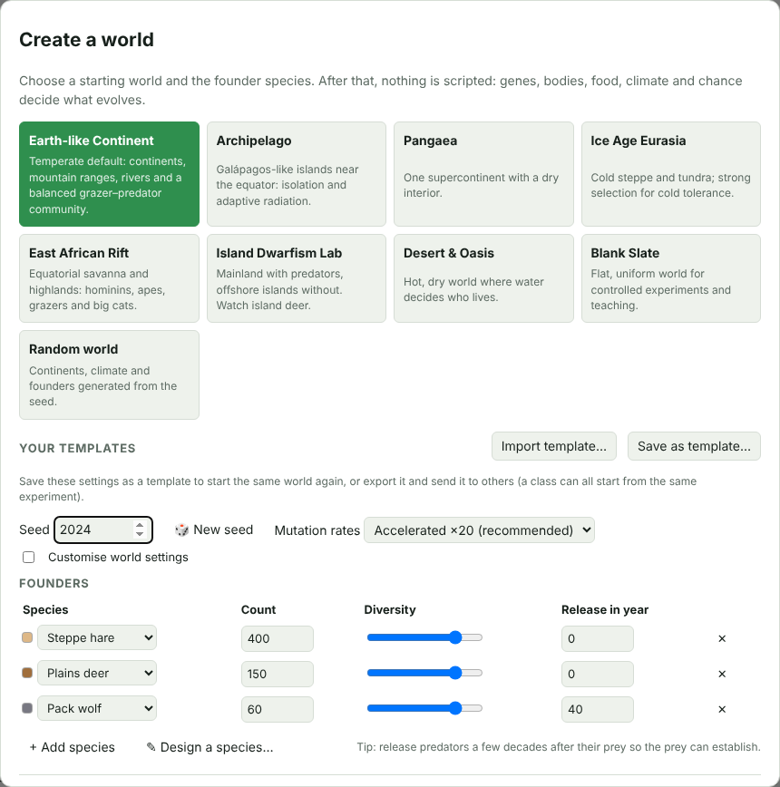

### Templates

Pick one of nine starting worlds, or one of [your own templates](#your-templates):

| Template | What it is for |
|---|---|
| **Earth-like Continent** | The default. Continents, mountain ranges, rivers and a grazer–predator community (hares, deer, wolves). |
| **Archipelago** | Galápagos-like islands near the equator. Isolation and adaptive radiation. |
| **Pangaea** | One supercontinent with a dry interior. |
| **Ice Age Eurasia** | Cold steppe and tundra. Strong selection for cold tolerance (watch insulation rise). |
| **East African Rift** | Equatorial savanna and highlands with early hominins, apes, grazers and big cats. |
| **Island Dwarfism Lab** | A mainland with predators and offshore islands without them. Watch the island deer. |
| **Desert & Oasis** | A hot, dry world where water decides who lives. |
| **Blank Slate** | A flat, uniform world for controlled experiments and teaching. |
| **Random world** | Continents, climate and founders generated from the seed. |

### Seed and mutation rates

- **Seed:** the same seed and settings always give the same history. Use **🎲 New seed** to try another roll of the dice.
- **Mutation rates:**
  - **Accelerated ×20** (recommended) multiplies literature mutation rates by 20 so change is visible sooner.
  - **Strict** uses literature rates, about 1 in 100,000 per gene per generation. Evolution is then as slow as in nature.

The setting you pick is shown again in the **World** tab.

### Founders

The founder table decides which species start the world:

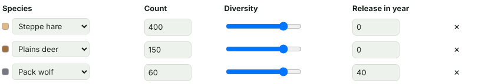

- **Species:** steppe hare, plains deer, pack wolf, ambush cat, field mouse, early hominin, forest ape.
- **Count:** how many founders to release (2 to 20,000). Type freely: the value is checked when you leave the box or press **Enter**.
- **Diversity:** genetic variation among the founders. Low values model a bottleneck, such as a handful of castaways reaching an island.
- **Release in year:** when they appear. Predators do best released a few decades after their prey.
- **✕** removes a row, and **+ Add species** adds one.
- **✎ Design a species…** opens the species designer (below) and adds the species you design as a new row.

### Design a species

The species designer makes a founder species of your own, such as "a small cold-adapted grazer", to test ideas the library does not cover.

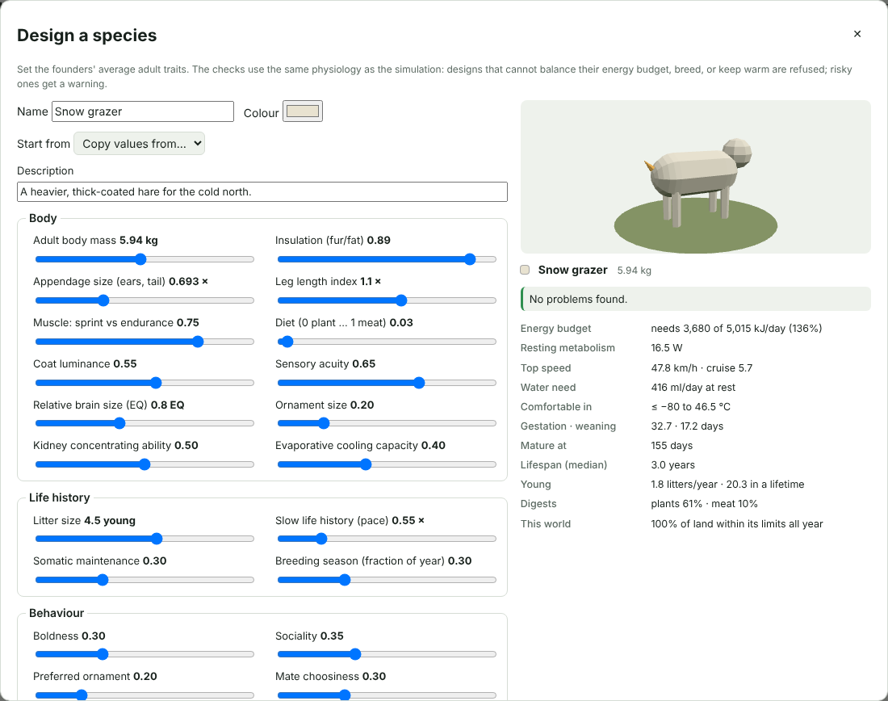

1. Click **✎ Design a species…** under the founder table (or **Design…** next to **Introduce species** in the World tab). The designer opens with the steppe hare's values.
2. Give the species a **Name** and a **Colour**. **Start from** copies the values of a library species or of one of your own, and keeps the name.
3. Move the sliders. They set the founders' average adult traits: body (mass, insulation, legs, diet, brain and so on), life history (litter size, pace of life, maintenance, breeding season) and behaviour. Body mass uses a log scale, from 10 g to 6 t.
4. **Founder variation** sets how much the founders differ from each other: 1 is as much as a library species. More variation gives selection more to work with; the **Diversity** column in the founder table still sets how many different alleles they carry.
5. Watch the right-hand side as you go. It shows the body in 3D (legs, tail plume and coat as in the 3D world), and values worked out with the same physiology the simulation uses: the daily energy budget, resting metabolism and the brain's share of it, top speed, water need, the air temperatures it is comfortable in, gestation, maturity, lifespan, young per lifetime, and how well it digests plants and meat. Opened from the World tab, it also says how much of the current world's land stays within its temperature limits all year.
6. Click **Save species**. The species is kept in this browser under **My species**, and can be picked in the founder table and in **Introduce species**.

The designer checks every change:

| Check | Refused when | Warned when |
|---|---|---|
| **Energy budget** | Field metabolism (2.5 × resting, which includes the cost of brain, insulation, ornaments and other costly traits) plus breeding needs more than its gut can process. | Less than 10% to spare: it will likely starve whenever food is short. |
| **Breeding** | Growing a litter during gestation needs more energy than it has to spare, it dies of old age before its first young are born, or a female has fewer than 2 young in her lifetime. | Fewer than 4 young in a lifetime. |
| **Brain cost** | — | The brain uses more than 12% of resting energy. |
| **Thermal limits** | No air temperature lets it keep its body temperature. | A comfort range narrower than 15 °C; or, against a world, little or no land stays within its limits all year ("will likely die out here"). |
| **Diet** | — | Notes only: plant-eaters under about 3.5 kg cannot digest coarse forage (Jarman–Bell), and mixed diets digest both foods less well. |

A refused design shows **Rejected** with the reason, the slider concerned is marked in red (amber for a warning), and **Save species** stays disabled until you fix it. Every library species passes these checks.

A design made of a library species' values behaves exactly like that species, animal for animal. Designed species travel with the world: they are in its save file and replay log, and a template saved from the world includes the ones its founders use, so whoever opens the template gets them too. Under **My species** in the Create dialog, **✎** edits a design and **✕** removes it from this browser (not from worlds that already use it).

### Customise world settings

Tick **Customise world settings** to change the world generator:

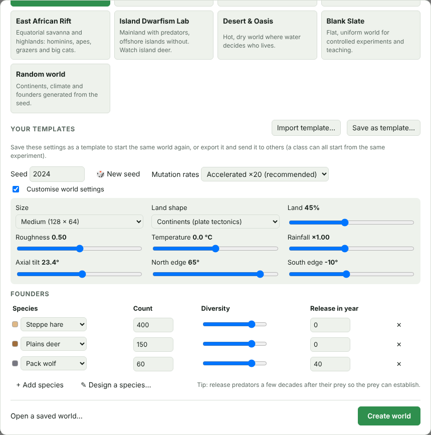

| Setting | Effect |
|---|---|
| **Size** | 96 × 48 up to 256 × 128 tiles. Bigger worlds hold more populations but run slower. |
| **Land shape** | Continents (plate tectonics), Supercontinent, Archipelago, Mainland and islands, Rift valley, or Flat. |
| **Land** | The fraction of the world that is land. |
| **Roughness** | How rugged the terrain is. |
| **Temperature** | A global offset in °C. |
| **Rainfall** | A multiplier on precipitation. |
| **Axial tilt** | Seasonality. 0° means no seasons; Earth's tilt is 23.4°. |
| **North edge / South edge** | The latitudes the map spans. This sets how much climate varies from top to bottom. |

Click **Create world** to generate the terrain, climate, rivers and biomes and release the founders.

### Your templates

A template keeps a world's starting point: the world settings, seed, mutation rates and founder table, with a name and a description. Use one to start the same experiment again, or to give a whole class the same starting world.

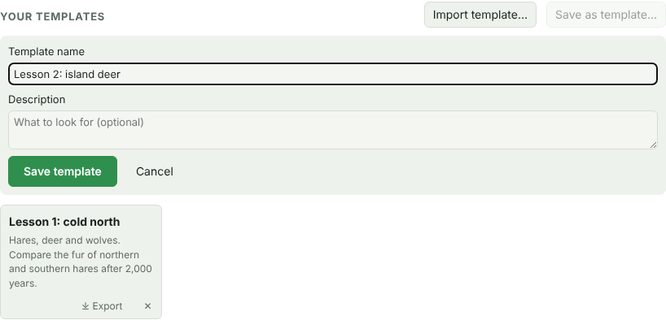

- **Save as template…** (under **Your templates** in the Create dialog) keeps the dialog's current settings. Give it a name and, if you like, a note on what to look for.
- **Save as template…** in the **World** tab (under **Template**) does the same for the open world, and also downloads the file. It saves how the world was created, not what has happened since.
- Saved templates are listed under **Your templates**. Click one to fill in its settings; you can still change the seed or founders before creating the world. A world made from it is the same world, animal for animal, as the one the template was saved from, as long as you keep its seed.
- Edits painted with the world editor at year 0, before time first runs, are part of the template (see [Edit the world](#edit-the-world)); later edits are not.
- Designed species the founders use are part of the template (see [Design a species](#design-a-species)).
- **⤓ Export** downloads the template as a small `.evotemplate` file to send to others. **Import template…** adds a file someone sent you. **✕** removes a template from this browser.

Templates are kept in this browser, like the autosave, so export the ones you want to keep. A file that is damaged, edited to impossible values (such as a count of 0 or a latitude beyond 90°), or made by a newer version of the app is refused with a message saying why. The format is described in the TRD (TR-DA5). The command-line runner reads the same files: `evo run --template-file lesson.evotemplate`.

---

## 2. The main screen

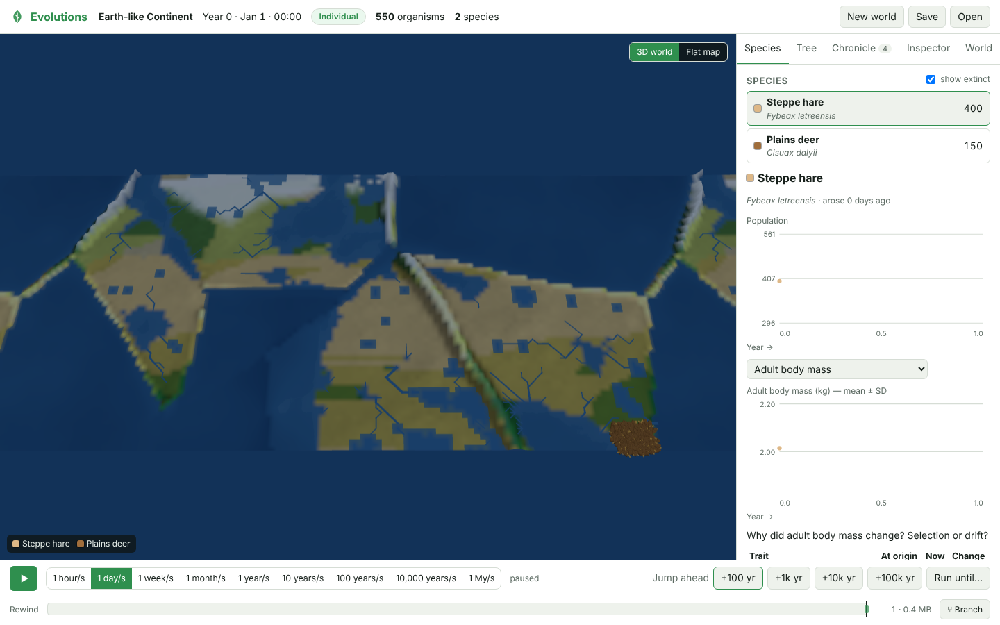

- **Top bar:**
  - the world name and the simulated date;
  - the mode badge (**Individual** or **Population**);
  - the number of living organisms and species;
  - **New world**, **Save** and **Open**.
- **3D world:** the whole simulation in one scene. Mountains rise in relief, seas are translucent water over the sea floor, rivers wind down to the sea (wider where more water flows), lakes lie flat in their basins, and biomes are coloured by type (deserts, grasslands, forests, tundra, ice). Snow covers the ground wherever the day is below freezing, so it spreads and retreats with the seasons. Zoom in and trees and grass appear: conifers in boreal and temperate rainforest, broadleaf trees in other forests and scattered over savanna, grass tufts on open land. Grass thins and dries from green to straw where animals have grazed it down, and comes back as it regrows (plants show on the Terrain and Vegetation layers). Plants follow the seasons too: broadleaf trees in temperate lands turn gold or red in autumn, stand bare through winter and leaf out in spring (half a year apart in the two hemispheres), and snow settles on the trees and buries the grass. Every animal stands on the ground in its species colour. The world wraps east–west, like a globe.
  - The sun follows the latitude you are looking at and the season: high in summer, low in winter, never setting at midsummer and never rising at midwinter beyond the polar circles.
  - The sun casts shadows: trees, mountains and animals throw long shadows when the sun is low, and short ones at midday.
  - At slow speeds (up to about **1 hour/s**) day turns to dusk and night, with the sun crossing from east to west. Faster, the light is the day's mid-morning sun, so the seasons still show; it dims during the polar night.
  - Drag to pan, scroll to zoom toward the pointer, and **right-drag** (or **Ctrl + drag**) to orbit and tilt the view.
  - The **3D world / Flat map** switch in the top-right corner changes to a flat top-down map. The app remembers your choice. Browsers without 3D graphics (WebGL) get the flat map automatically.
  - The legend in the bottom-left corner names the species colours.
- **Side panel:** the **Species**, **Tree**, **Chronicle**, **Inspector** and **World** tabs.
- **Time bar:** play/pause, speed presets, the achieved speed, **Jump ahead** buttons and **Run until…**, with the **Rewind** strip of checkpoints underneath.

---

## 3. Watch individual animals

Press **▶** (or **Space**). In Individual mode every animal lives hour by hour: it forages, looks for water, rests in shade when hot, flees predators, hunts, courts, gives birth and nurses its young. Zoom in to see each animal as a small four-legged figure in its species colour; animals walk smoothly between positions, swing their legs and face the way they go, and resting animals crouch. Each body shows its own phenotype: heavier animals are bigger (young ones smaller), long-legged ones stand taller, the coat is lighter or darker with coat luminance, and an orange tail plume grows with the ornament trait. Far away, figures keep a minimum size so a herd stays visible; above about 20,000 figures, distant ones are drawn as flat silhouettes so the view stays smooth.

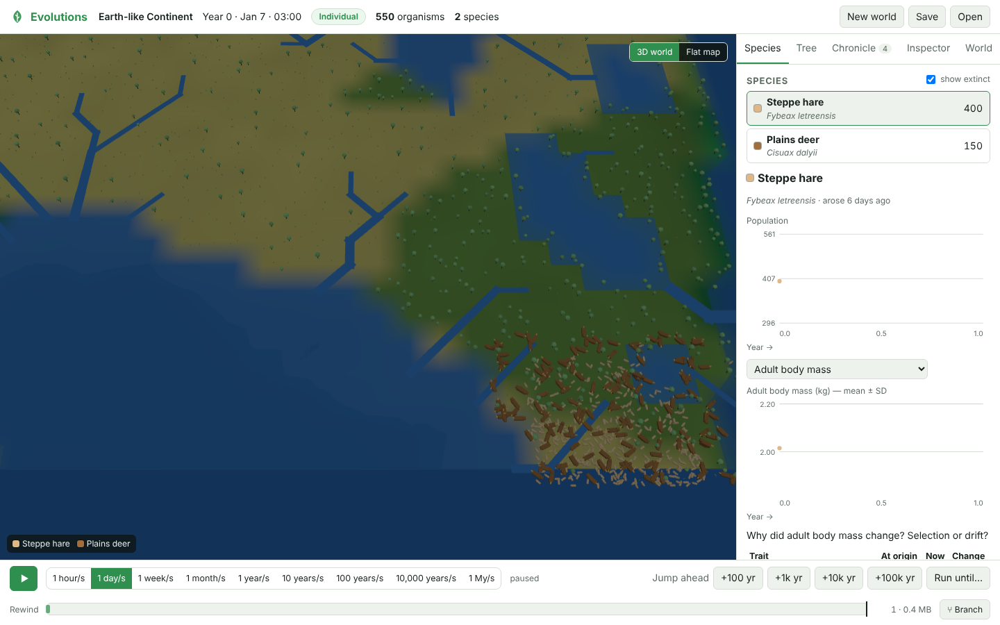

**Click an animal** to open the **Inspector**. A yellow ring marks it on the map, and the panel updates live as it lives its life. In the 3D world, **Follow animal** (top right, under the view switch) keeps the camera on it as it moves; you can still zoom and orbit. Dragging the map, choosing another animal, or the animal dying stops following. A yellow trail shows where it has walked over the last day, fading with age.

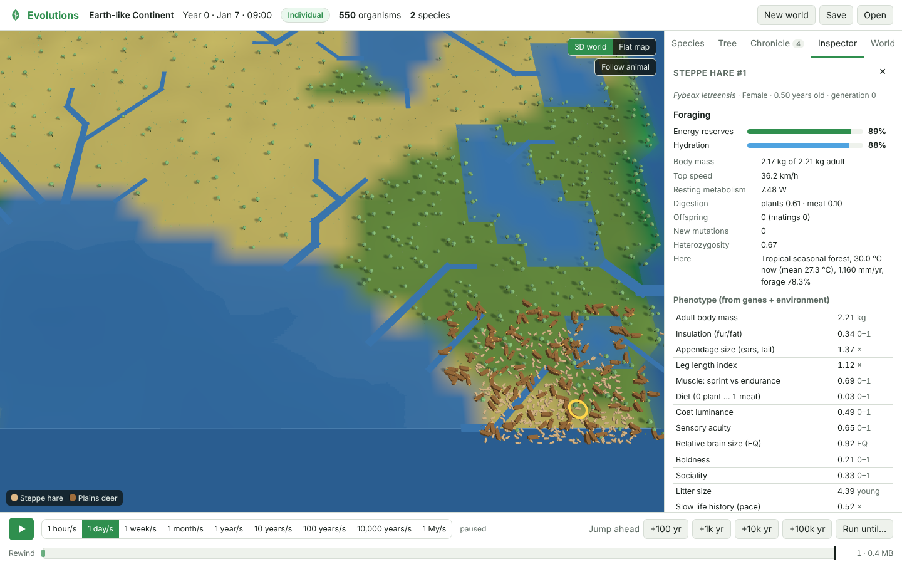

The Inspector shows:

- **Identity:** species, sex, age and generation.
- **What it is doing now**, for example Resting, Foraging, Looking for water, Fleeing, Seeking a mate or Following mother.
- **Energy reserves and hydration:** when either runs out, the animal dies of starvation or dehydration.
- **Body:** current and adult mass, top speed, resting metabolism, and how well it digests plants and meat.
- **Family:** offspring, matings, new mutations it carries, and genetic heterozygosity.
- **Here:** the biome, the temperature now and on average, rainfall, and how much forage is left on its tile.
- **Phenotype:** all 21 heritable traits, as developed from its genes plus its environment.

If the animal dies (or, while you watch a region, walks out of it), the Inspector keeps its last known state and says so, and the map stops marking it. Close it with **✕**.

---

## 4. Control time

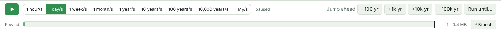

| Control | What it does |
|---|---|
| **▶ / ❚❚** | Play or pause (**Space**). |
| **Speed presets** | **1 hour/s**, **1 day/s** and **1 week/s** suit watching animals. From **1 month/s** up, Auto mode switches to Population mode, so these suit watching populations and evolution. **10,000 years/s** and **1 My/s** switch to Macro mode for deep time. |
| **≈ speed** | The speed actually achieved, averaged over about a second. Very large worlds may run slower than the preset. |
| **Jump ahead +100 / +1k / +10k / +100k yr** | Fast-forwards that many years as fast as possible. Jumps of 20,000 years or more use Macro mode. |
| **Run until…** | Fast-forwards until something happens (see [section 10](#10-run-until-something-happens)). |

During a jump, a progress card shows the year reached. **Stop here** ends the jump at the current year. Play, pause and the jump buttons are disabled until the jump ends. If every organism dies during a jump, it stops and says so.

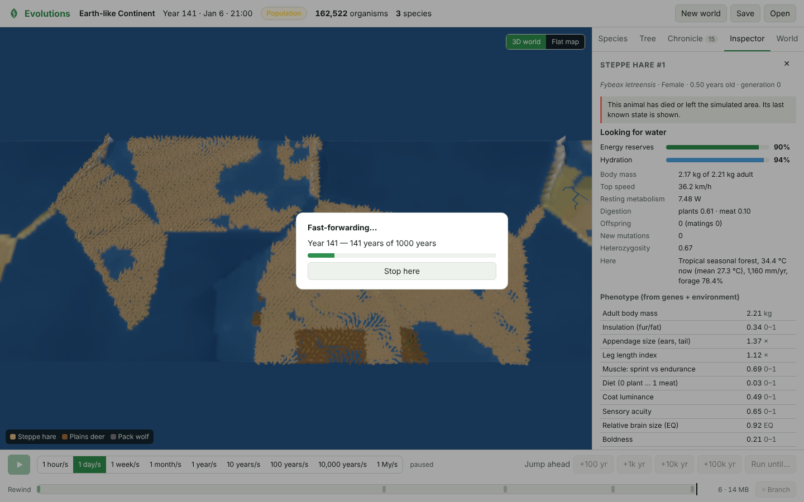

### Rewind

The app keeps checkpoints of the world as it runs, so you can go back to an earlier point, watch a population crash again, or try a different intervention, without starting over.

The **Rewind** strip under the time bar runs from the start of the world (left) to now (the white line on the right). Each mark is a checkpoint; hover it to see its year. Click a mark to rewind to it.

- Checkpoints are taken when the world is created or opened, every 10 simulated years (at most about one a second while fast-forwarding, and at least every 30 seconds while time runs slowly), just before each jump (green marks) and just before each intervention (yellow marks).
- They are compressed and kept in memory, up to 200 MB. When that fills up, older checkpoints are thinned out: the recent past keeps many, the distant past fewer. The number of checkpoints and the memory they use are shown on the right.
- **Rewinding discards what happened after the checkpoint**, including later checkpoints. Running forward again from the same checkpoint, with the same actions, gives exactly the same world as the first time.
- In the **Chronicle**, the **⟲** button on an entry rewinds to the latest checkpoint before that event (for example, just before a climate shift you applied).
- Checkpoints last for this session only. To keep a point in time, use **Save**.

---

## 5. Individual, Population and Macro modes

Simulating every animal hour by hour is too slow for thousands of years, so Evolutions has three levels of detail. All three use the same biology.

| Mode | What is simulated | Used for |
|---|---|---|
| **Individual** | Every organism, one hour at a time. | Watching behaviour; short spans of time. |
| **Population** | Groups (demes) in each 8 × 8-tile patch, one year at a time. Each group tracks its age structure and the frequency of every gene variant, under selection, drift, mutation and migration. | Centuries to tens of thousands of years. |
| **Macro** | The same groups, 1,000 years at a time. | Hundreds of thousands to millions of years: adaptive radiations, speciation and extinction. |

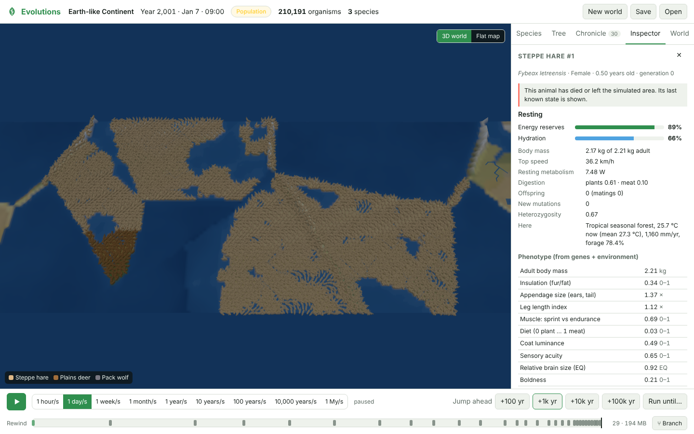

In Population mode the 3D world shows each population as a few translucent figures per area in its species' colour (more where it is denser), and species ranges as colour over the terrain. Each tile takes the colour of its most abundant species, more strongly where that species is denser.

**Choosing the mode.** In the **World** tab, **Simulation detail** has four settings:

- **Auto** (default) uses Individual mode up to about 1 week/s, Population mode at higher speeds and for jumps, and Macro mode at 10,000 years/s and above and for jumps of 20,000 years or more. It also switches to Population mode if the population grows too large to follow one by one (more than 25,000 animals). Slowing down switches back.
- **Individual**, **Population** or **Macro** keeps that mode while time plays. Some things still override the choice:
  - jumps of more than 2 years always run in Population mode or, for 20,000 years or more, in Macro mode; afterwards the app returns to the chosen mode, or to Individual mode only if the world is small enough;
  - a world of more than 25,000 animals can't be simulated one by one. The app switches to Population mode and suggests watching a region instead (see [section 11](#11-watch-a-region-in-a-crowded-world)).

The badge at the top shows the mode in use: **Individual**, **Population** (yellow) or **Macro** (blue). Switching between Population and Macro mode changes nothing in the world: both hold the same groups.

### Macro mode

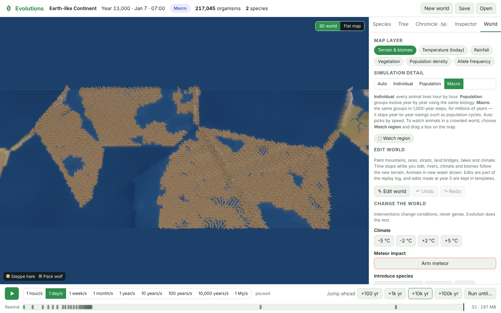

Macro mode moves 1,000 years per step, so a million years takes a few minutes. Each step:

1. **Numbers and range:** each group's births, deaths and dispersal are worked out with the Population-mode model for 40 years, with traits held fixed, so numbers and the range settle. A decline that isn't caused by crowding (the group has enough food) continues for the rest of the step. Numbers are then rounded with chance, so small groups can die out.
2. **Traits:** each trait's average moves towards the value natural selection favours there, at a speed set by its genetic variation. Every 100 years the step measures again how survival and reproduction change with the trait, because traits evolve together and the best value shifts as they do. Gene flow pulls neighbouring groups together, and drift adds chance changes, larger in small groups.
3. **Genes:** gene variants flow between neighbouring groups, drift (connected groups drift together), mutate and are selected against in hybrid-incompatible combinations. Their frequencies are then adjusted so each group's traits match step 2.

New species are detected as in Population mode, from accumulated incompatibilities and mating differences.

**What Macro mode leaves out:**
- year-to-year swings: population cycles, a bad winter, a predator boom and bust. You see where numbers settle each 1,000 years, not the path in between;
- the order of events within a step: an intervention or climate change takes effect at the next step;
- fine detail of selection: traits change in step with Population mode only on average. Over 1,000 years they stay within about 20% of a Population-mode run from the same start, and numbers within about 25%. A trait under runaway selection may change more slowly than in Population mode.

For a close look at any period, slow down or jump less than 20,000 years: the world continues in Population mode from exactly where Macro mode left it.

---

## 6. Species: populations and traits over time

The **Species** tab lists every species. Living species come first, sorted by abundance; tick **show extinct** to include extinct ones (marked with † and the year they died out). Click a species to see its history.

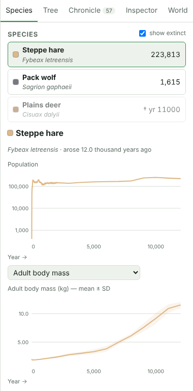

- **Population chart:** abundance over time on a log scale. Hover over it to read exact values.
- **Trait chart:** pick any trait from the drop-down. The chart shows the species' mean (line) and spread (± one standard deviation, the shaded band) over time.
- **Trait table:** the main traits at the species' origin and now, with the percentage change. Increases are green and decreases red. Click a row to chart that trait.
- **Neutral genetic diversity:** heterozygosity at neutral marker genes. It falls in small or bottlenecked populations.
- **Why did this trait change? Selection or drift?** Under the trait chart, this link explains the charted trait's change since the species arose, in the same way as the Chronicle's [Why?](#why). It works for every trait, including ones nothing selects on, such as boldness, which simply drift:

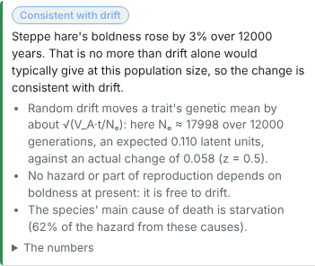

Below these, **Population genetics** has the textbook measures, from neutral marker genes, recorded at each metrics sample:

- **Expected heterozygosity:** the chance that two gene copies drawn at random differ, for the whole species (H_T) and within each map patch (H_S). Drift lowers it by about 1/(2Nₑ) per generation; mutation raises it.
- **F_ST between patches:** (H_T − H_S) / H_T, how much of the species' diversity lies *between* places. It stays near 0 in one well-connected population and rises when populations are cut off from each other, for example by a strait.
- **Population size: census and effective (Nₑ):** the census count, Nₑ from the adult sex ratio (4·males·females / (males + females)), and Nₑ from how fast heterozygosity has fallen over the last 20 generations, corrected for mutation. The last appears only when heterozygosity is falling measurably, which takes a small population.
- **Segregating alleles:** how many alleles are present at genes that have more than one. It falls in a bottleneck and recovers slowly through mutation.
- **Allele frequency:** pick up to five alleles from **Add allele…** (the same list as the allele-frequency map layer) to plot their share of the species' gene copies over time; × removes one. The most variable allele is charted to start with. A line ends where an allele was lost, fixed or fell below 1%.

Worlds saved before these charts existed open with empty charts, which then fill from the moment they were opened.

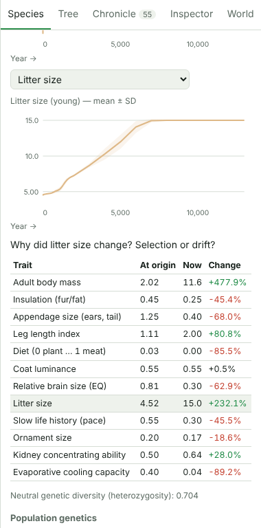

In this run, hares evolved larger litters (+70%), better water-conserving kidneys (+46%), longer legs and larger bodies. Nobody programmed those outcomes: they emerged from the hares' energy budget, predation by wolves, and the climate.

---

## 7. Tree of life

The **Tree** tab draws every lineage as a line from its origin to the present, or to its extinction (dashed, with †). When the simulation detects that two populations of a species can no longer interbreed successfully, a daughter species branches off its parent. The cause is recorded as either geographic separation (allopatric) or divergence without a barrier.

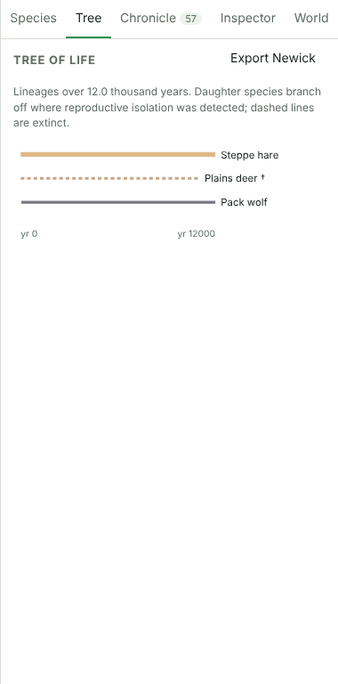

- Click a branch to open that species in the **Species** tab.
- **Export Newick** downloads the tree as a `.nwk` file for phylogenetics tools such as FigTree, iTOL or R/ape.

New species take time. They arise fastest in small, isolated populations, such as on islands (try **Archipelago** or **Island Dwarfism Lab** and jump 10,000+ years), and much more slowly in large connected ones, as in nature.

---

## 8. Chronicle

The **Chronicle** tab is the story of your world, newest first. Each entry has the year and, where relevant, the species colour (click it to open that species).

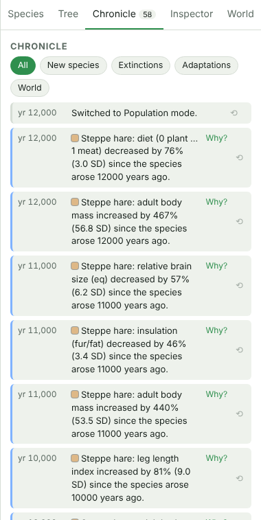

It records:

- **Adaptations:** a trait shifted by 3, 6, 9 … standard deviations since the species arose, for example *"litter size increased by 70%"*.
- **New species**, **extinctions** and **population crashes**.
- **World events:** founders released, mode switches, interventions, and climate recovering after an impact winter.

Use the filter chips (**All**, **New species**, **Extinctions**, **Adaptations**, **World**) to focus on one kind of event.

The **⟲** button at the end of an entry goes back to just before that event (see [Rewind](#rewind)).

### Why?

Adaptations, population crashes, extinctions and new species have a **Why?** link. It opens a panel that says, in plain language, what caused the event, with the evidence underneath:

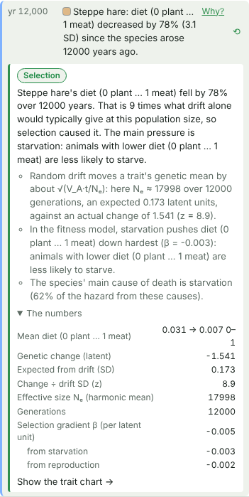

- **Trait changes** get a verdict: **Selection**, **Consistent with drift**, or **Selection and drift**. Random genetic drift moves a trait's average by about √(V_A·t/Nₑ) over t generations (V_A is the trait's additive genetic variance, Nₑ the effective population size). The panel compares the actual change with that: more than 3 times as large is selection, less than 2 times is consistent with drift, and in between is mixed. Large populations drift very little, so a steady change in a big population is almost always selection; in a small one, even a large change can be chance.
- It then names the **hazard the trait affects most** and which way it pushes: for example *"The main pressure is cold stress: animals with higher insulation suffer less cold stress"*, and what holds the change back (*"animals with higher insulation need more food"*). These come from splitting the trait's selection gradient (β) into starvation, dehydration, predation, heat stress, cold stress, ageing and reproduction. Cold and heat include the stress newborns face in their birth month.
- **Crashes and extinctions** name the hazard that grew most between the population's peak and the crash (or, if none rose, the one that stayed high), and the matching cause: a food shortage (often a population that outgrew its food), a new predator or more predators, a climate shift, or one of your interventions (a plague or a meteor).
- **New species** say whether the split was allopatric (and what separated the ranges: open water, mountains or a gap in the range) or parapatric, and which of the three isolation factors contributed most: hybrid incompatibilities, mate choice, or breeding at different times of year.

**The numbers** opens the values behind the answer, and the link at the bottom opens the chart that shows it (the trait's chart, the population chart, or the tree).

In Population mode the gradient comes from the same fitness model that moves allele frequencies, and allele frequencies are resampled every year, so each year counts as one generation of drift. Macro mode uses the same fitness model and the same yearly drift, measured at the start of each 1,000-year step. In Individual mode the hazards are measured from what the animals actually died of. Worlds saved before this feature have no explanations for their earlier events; new events are explained from the moment the world is opened.

---

## 9. Map layers

In the **World** tab, **Map layer** switches what the map shows:

| Layer | Shows |
|---|---|
| **Terrain & biomes** | The default view: biomes, relief and water, plus individuals or species ranges. |
| **Temperature (today)** | Today's temperature from blue (cold) to red (hot). It changes with the seasons and with climate interventions. |
| **Rainfall** | Annual precipitation from brown (dry) to teal (wet). Look for rain shadows behind mountain ranges. |
| **Vegetation** | How much forage is left compared with what the land can grow. Grazing pressure shows up as browner areas. |
| **Population density** | Organisms per tile on a heat scale, for **all species** or one species picked in **Density of**. In the 3D world each occupied tile becomes a column: the taller and brighter, the denser. |
| **Allele frequency** | How common one allele (gene variant) of a species is in each patch, from dark purple (absent) to yellow (every gene copy). Pick the **Species** and then the **Allele**: the list shows the species' variable alleles (between 1% and 99% of gene copies), trait genes first, each with its effect on the trait (on the genetic scale), whether the founders carried it or it arose as a mutation (and in which year), and its share in the whole species. Watch a new mutation spread out from where it arose, or a cline form along a climate gradient. |

In the 3D world the chosen layer is draped over the relief, so you can see, for example, the cold along a mountain spine or the dry side of a range.

| | |
|---|---|
| 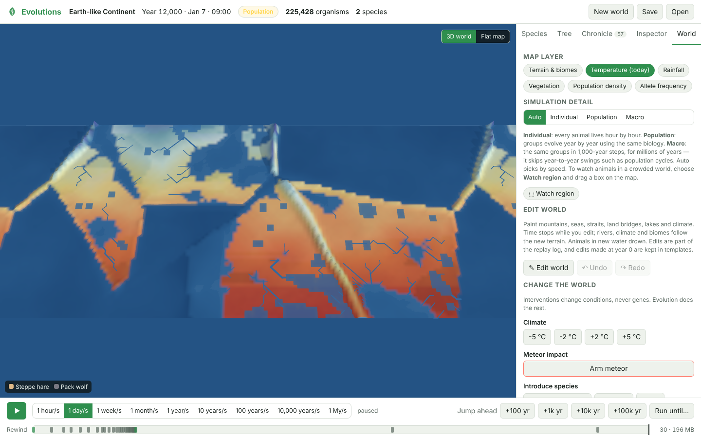 | 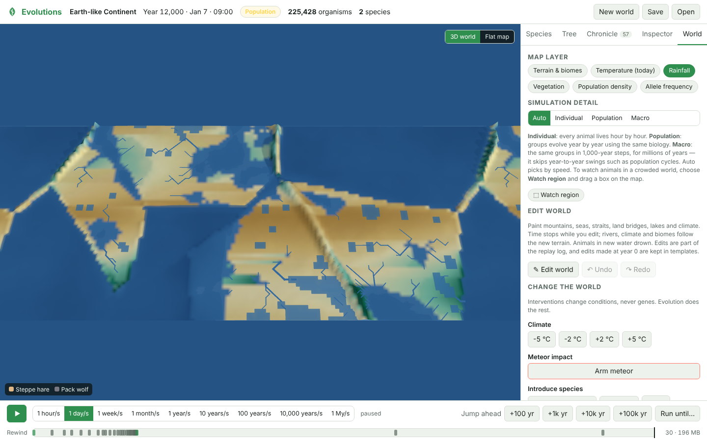 |
| 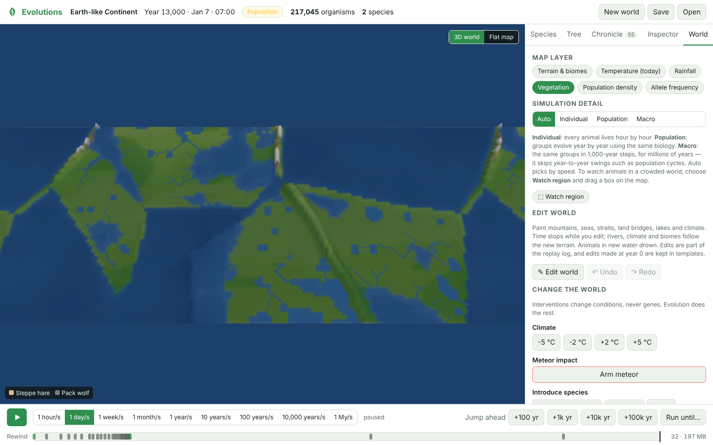 | 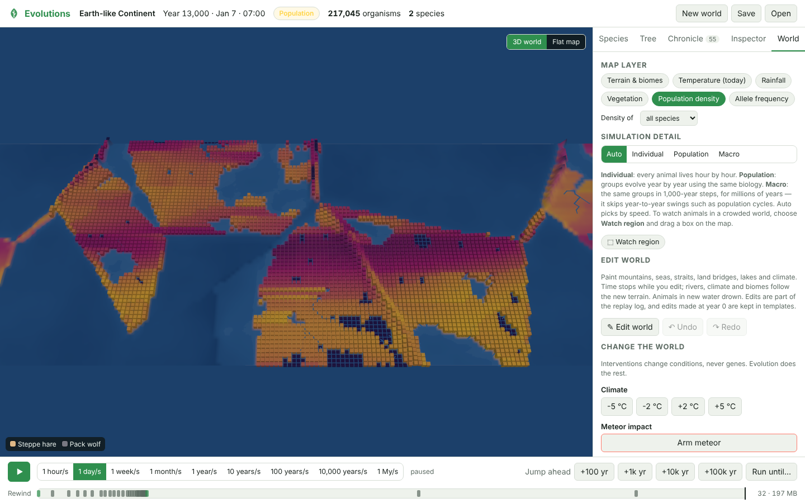 |

---

## 10. Run until something happens

**Run until…** fast-forwards until a condition is met, so you do not have to keep pressing Jump.

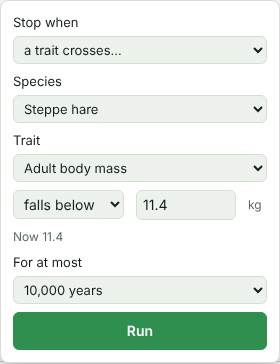

Stop when:

- **a new species arises**;
- **a species goes extinct**;
- **population crosses…** a threshold, above or below, for one species or all;
- **a trait crosses…** a threshold, for example when steppe hare adult body mass rises above 3 kg. The current value is shown for reference.

**For at most** caps the run at 100 to 100,000 years. If the condition is already true when you start, the app says so and runs the full length.

---

## 11. Watch a region in a crowded world

Once a world holds more than about 25,000 animals, they can't all be simulated one by one. You can still watch animals in any part of the world:

1. In the **World** tab, click **⬚ Watch region**, or hold **Shift** on the map.
2. Drag a box over the area you want to watch.

The animals in that box become individuals; the rest of the world waits as groups until you return to Population mode. A dashed outline marks the region, the badge reads **Individual · region**, and **Simulation detail** shows **Individual** while you watch.

The box can cross the map's left or right edge: the world wraps east–west, so a box dragged across the edge covers both sides of it.

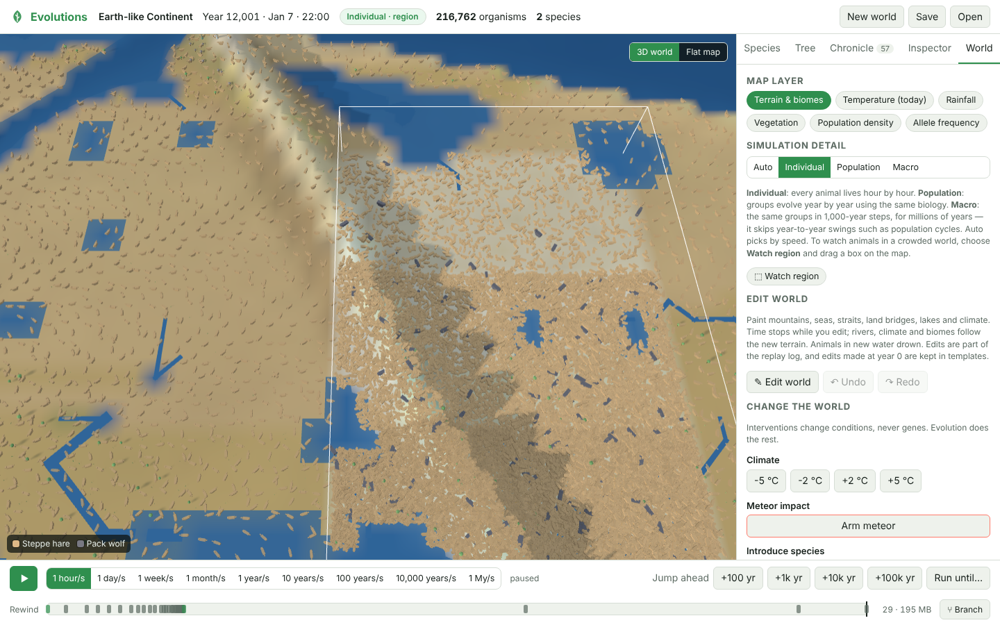

If the box holds too many animals, the app asks you to choose a smaller area.

The region ends when you pick **Population** or **Auto**, or when you jump ahead. After a jump, **Simulation detail** returns to the setting you had before you started watching.

---

## 12. Change the world (interventions)

Interventions change **conditions only, never genes**. Evolution does the rest. Each one is logged in the Chronicle.

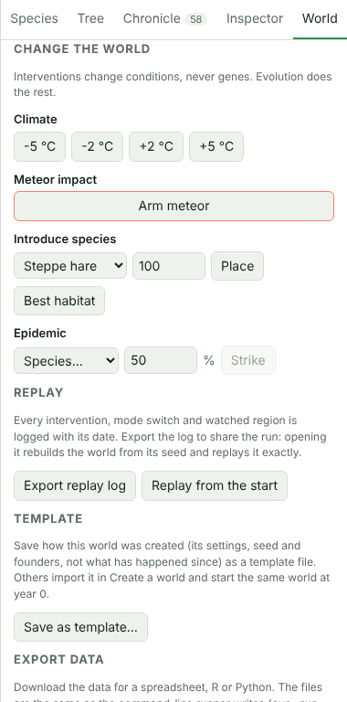

| Intervention | How to use it | Effect |
|---|---|---|
| **Climate** | Click **−5 °C**, **−2 °C**, **+2 °C** or **+5 °C**. | Shifts global temperature. Biomes, plant growth and heat or cold stress change; watch insulation, body size and ranges respond. The current offset is shown below the buttons. |
| **Meteor impact** | Click **Arm meteor**, then click the map. | Kills nearly everything within the blast radius, strips vegetation, and causes an impact winter (−4 °C for about 8 years). |
| **Introduce species** | Pick a species and a count, then **Place** (and click the map) or **Best habitat**. **Design…** makes a new species, checked against this world (see [Design a species](#design-a-species)). | Releases new founders. Good for invasive-species or predator-reintroduction experiments. If there is no suitable habitat where you click (open ocean, for example), the app says so and nothing is added. |
| **Epidemic** | Pick a species and a mortality %, then **Strike**. | Kills that share of the species, creating a bottleneck. Watch genetic diversity drop. |

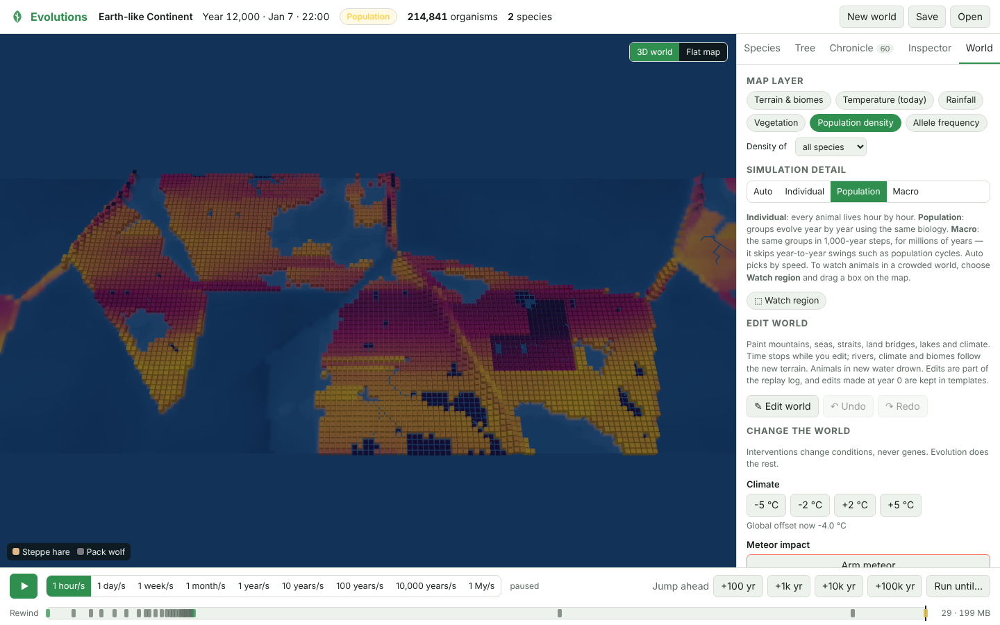

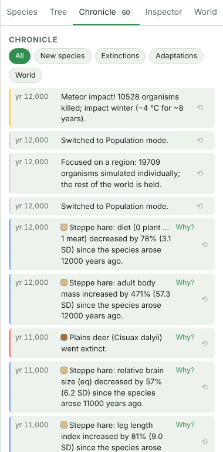

### Edit the world

The world editor paints terrain and climate onto the world, so you can build exactly the barrier, island or land bridge an experiment needs: cut a continent in two with a strait and watch the halves diverge, or join two islands and watch species meet.

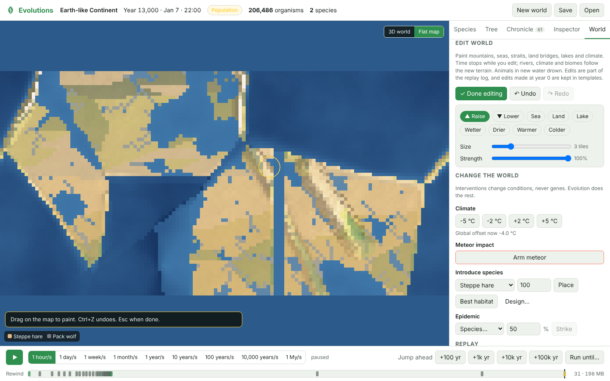

1. In the **World** tab, click **✎ Edit world**. Time stops; it stays stopped while you edit (pressing play still works, and painting pauses it again).
2. Pick a brush, a **Size** (radius in tiles; the smallest paints one tile) and a **Strength**.
3. Drag on the flat map or the 3D world. The brush outline follows the pointer on the flat map. When you let go, the stroke is applied: rivers re-route, lakes fill, and temperature, rainfall, biomes and plant growth follow the new terrain.
4. **↶ Undo** (Ctrl+Z) and **↷ Redo** (Ctrl+Shift+Z or Ctrl+Y) step through your strokes; undo restores the world exactly as it was. Once time runs again, earlier strokes can no longer be undone (use **Rewind** instead).
5. Click **✓ Done editing** (or press Esc).

| Brush | What it does |
|---|---|
| **▲ Raise / ▼ Lower** | Raises or lowers the ground, up to 1,500 m per stroke at full strength, softer towards the brush edge. Lowering land below sea level makes it sea; raising the sea floor above it makes land. |
| **Sea** | Makes every tile under the brush sea (10–500 m deep by strength). A one-tile-wide sea is enough to stop animals walking across. |
| **Land** | Makes every tile under the brush land (20–300 m high by strength): a land bridge or a new island. |
| **Lake** | Digs a basin that fills with fresh water. Lakes must be inland: a basin open to the sea drains. |
| **Wetter / Drier** | Adds or removes up to 1,000 mm of rain a year. |
| **Warmer / Colder** | Changes the local average temperature by up to 10 °C. |

Animals standing where the brush makes sea or a lake drown, and the Chronicle says how many. Each stroke is logged in the Chronicle and in the replay log, so a replay paints the same strokes at the same moments and ends in the same world. Painted rainfall and temperature stay when you later reshape the terrain around them.

At the bottom of the **World** tab, **Deaths so far** breaks down causes of death recorded while animals are simulated individually: starvation, dehydration, predation, old age, heat stroke, cold, accidents, catastrophes and non-viable embryos (failed hybrids). It also shows births, the number of gene variants tracked and the mutation rate in use.

---

## 13. Save, open, resume and replay

- **Save** (top bar) downloads the whole world as an `.evo` file: terrain, every genome, populations, species, history and chronicle.
- **Open** (top bar, or **Open a saved world…** in the Create dialog) loads an `.evo` file and continues exactly where it left off. The same seed and save always continue identically. A damaged file is rejected with a message, and the current world stays open. Saves from older versions of the app still open.
- **Autosave:** the app also keeps your latest world in the browser. It saves when the world is created or opened, after each jump, and once a minute while anything changes (time running, or an intervention while paused). When you come back, the Create dialog offers **Continue where you left off?** with the template, seed, year and save time; click **Resume**.

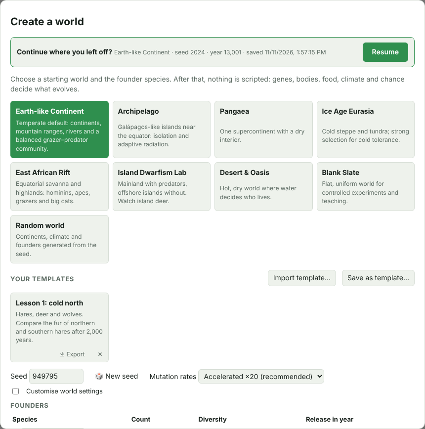

Autosave is per browser and is lost if you clear site data, so use **Save** for worlds you want to keep or share.

### Replay

The app logs everything you do to a world with its date: interventions, introduced species, mode switches (including the automatic ones for speed and jumps) and watched regions. The log is kept in saves and autosaves.

- **Export replay log** (**World** tab, under **Replay**) downloads a small `.json` file: the world's settings and seed plus the log. It is much smaller than an `.evo` save.
- **Open** a replay log (top bar or the Create dialog) to rebuild the world from its seed and replay every logged action at its date, up to the date it was exported. A progress card shows the year; **Stop here** cancels and keeps the current world.
- **Replay from the start** does the same for the current world, as a check.

When the replay ends, a message says whether the world is identical to the original run. It can differ if the log was made by another version of the app, or was edited. Worlds saved by versions without a replay log open normally but cannot be replayed.

### Export data

**Export data** (**World** tab) downloads the run's data for a spreadsheet, R or Python. The files are byte-for-byte the same as the command-line runner writes for the same save (`evo run --load run.evo --years 0 --csv out/ --chronicle chronicle.csv --newick tree.nwk --settings settings.json`). The runner's `--why why.json` also writes each event's "Why?" explanation as JSON.

- **Time series (CSV):** one file per species, named `species_<id>_<name>.csv`, or just the species chosen in the list. One row per metrics sample (sampled regularly, thinned evenly as a run grows long):

  | Column | Meaning |
  |---|---|
  | `year` | Simulated year |
  | `n` | Population size |
  | `het` | Mean neutral-marker heterozygosity |
  | `body_mass`, `insulation`, … | Mean of each trait, in the trait's unit (one column per trait, in the order of the Species panel) |
  | `body_mass_sd`, `insulation_sd`, … | Standard deviation of each trait |

  Extinct species keep their rows up to extinction.

  Each species also gets `species_<id>_<name>_popgen.csv`, the population-genetics measures above: `year`, `ht`, `hs`, `fst`, `ne` (sex ratio), `ne_h` (from heterozygosity loss; empty when it cannot be estimated), `generation_years` (the generation time `ne_h` uses) and `segregating_alleles`.
- **Chronicle (CSV):** columns `year`, `kind` (Info, Founders, Speciation, Extinction, Mode, Intervention, Crash, Adaptation), `species` (id, empty for world events), `species_name` and `text`. Fields with commas or quotes are quoted.
- **Phylogeny (Newick):** the same file as **Export Newick** in the Tree tab, with branch lengths in years.
- **Settings (JSON):** the template, seed, realism, world-generator settings and founder groups the world was created with, plus the model version and current year. `founders` is null for worlds saved before replay logs existed.

---

## 14. Keyboard and mouse reference

| Input | Action |
|---|---|
| **Space** | Play / pause. Ignored while you type in a box, during a jump, or when the key is held down. |
| **Esc** | Cancel the armed tool (meteor, place species, watch region, world editor), even while a box has focus. |
| **Ctrl+Z / Ctrl+Shift+Z** (or Ctrl+Y) | Undo or redo a world-editor stroke while the editor is on. |
| **Scroll** on the map | Zoom in or out at the cursor. |
| **Drag** on the map | Pan. The world wraps east–west. |
| **Right-drag**, or **Ctrl / Alt + drag** | Orbit and tilt the 3D world. |
| **Click** an animal | Open it in the Inspector (Individual mode). |
| **Shift + drag** on the map | Watch that region individually. The box may cross the east–west edge. |
| **Hover** a chart | Read exact values. |

---

## 15. Tips for good experiments

- **Try again from the same moment:** rewind to just before an event (the **⟲** in the Chronicle) and do something different, such as a smaller meteor or no epidemic.
- **Compare like with like:** use the same seed and change one thing, such as the climate, a founder count or mutation rates. Then compare the Species charts.
- **See natural selection:** the **Ice Age Eurasia** template with 1,000–5,000 years of jumps shows insulation rising. The **Desert & Oasis** template shows kidneys and heat tolerance improving.
- **See a bottleneck:** strike a species with a 90% epidemic, then watch its neutral genetic diversity in the Species tab.
- **See predator–prey dynamics:** in the Earth-like template, watch the wolf and hare population charts after the wolves arrive in year 40. Abundant hares can sustain enough wolves to wipe out the scarcer deer (apparent competition).
- **See speciation:** use small isolated populations (**Archipelago**, **Island Dwarfism Lab**) and **Run until… a new species arises** with a 100,000-year cap.
- **Deep time:** Population mode runs at roughly 40–90 simulated years per second, depending on world size, so use it for up to tens of thousands of years. For longer spans, jump 100,000 years or play at **10,000 years/s** or **1 My/s**: Macro mode covers a million years in a few minutes.
- **Strict vs Accelerated:** with **Strict** mutation rates, adaptation relies mostly on the variation founders already carry. That is realistic for short spans, but expect little change in new traits.

For how the biology works under the hood, see the [Technical Requirements](TRD.md). For the architecture, see the [System Design](SYSTEM_DESIGN.md).
