# Evolutions — User Guide

This guide walks through every feature of the Evolutions app in the order you will meet them. It covers creating a world, watching individual animals, fast-forwarding through deep time, reading what evolved, and changing the world.

All screenshots come from a single run of the Earth-like Continent template, seed 2024, over about 2,000 simulated years. Your own runs will differ: chance is part of evolution.

**Contents**

1. [Create a world](#1-create-a-world)
2. [The main screen](#2-the-main-screen)
3. [Watch individual animals](#3-watch-individual-animals)
4. [Control time](#4-control-time)
5. [Individual and Population modes](#5-individual-and-population-modes)
6. [Species: populations and traits over time](#6-species-populations-and-traits-over-time)
7. [Tree of life](#7-tree-of-life)
8. [Chronicle](#8-chronicle)
9. [Map layers](#9-map-layers)
10. [Run until something happens](#10-run-until-something-happens)
11. [Watch a region in a crowded world](#11-watch-a-region-in-a-crowded-world)
12. [Change the world (interventions)](#12-change-the-world-interventions)
13. [Save, open and resume](#13-save-open-and-resume)
14. [Keyboard and mouse reference](#14-keyboard-and-mouse-reference)
15. [Tips for good experiments](#15-tips-for-good-experiments)

---

## 1. Create a world

The **Create a world** dialog opens when the app starts. To open it again later, click **New world** in the top bar.

### Templates

Pick one of nine starting worlds:

| Template | What it is for |
|---|---|
| **Earth-like Continent** | The default. Continents, mountain ranges, rivers and a grazer–predator community (hares, deer, wolves). |
| **Archipelago** | Galápagos-like islands near the equator. Isolation and adaptive radiation. |
| **Pangaea** | One supercontinent with a dry interior. |
| **Ice Age Eurasia** | Cold steppe and tundra. Strong selection for cold tolerance (watch insulation rise). |
| **East African Rift** | Equatorial savanna and highlands with early hominins, apes, grazers and big cats. |
| **Island Dwarfism Lab** | A mainland with predators and offshore islands without them. Watch the island deer. |
| **Desert & Oasis** | A hot, dry world where water decides who lives. |
| **Blank Slate** | A flat, uniform world for controlled experiments and teaching. |
| **Random world** | Continents, climate and founders generated from the seed. |

### Seed and mutation rates

- **Seed:** the same seed and settings always give the same history. Use **🎲 New seed** to try another roll of the dice.
- **Mutation rates:**
  - **Accelerated ×20** (recommended) multiplies literature mutation rates by 20 so change is visible sooner.
  - **Strict** uses literature rates, about 1 in 100,000 per gene per generation. Evolution is then as slow as in nature.

The setting you pick is shown again in the **World** tab.

### Founders

The founder table decides which species start the world:

- **Species:** steppe hare, plains deer, pack wolf, ambush cat, field mouse, early hominin, forest ape.
- **Count:** how many founders to release.
- **Diversity:** genetic variation among the founders. Low values model a bottleneck, such as a handful of castaways reaching an island.
- **Release in year:** when they appear. Predators do best released a few decades after their prey.
- **✕** removes a row, and **+ Add species** adds one.

### Customise world settings

Tick **Customise world settings** to change the world generator:

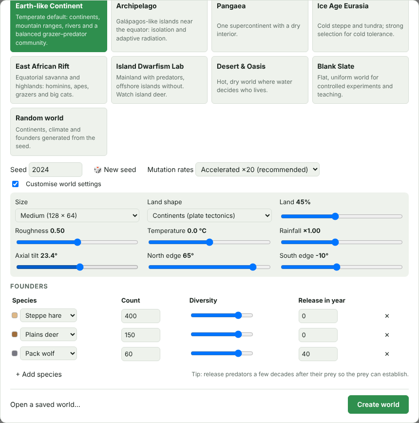

| Setting | Effect |
|---|---|
| **Size** | 96 × 48 up to 256 × 128 tiles. Bigger worlds hold more populations but run slower. |
| **Land shape** | Continents (plate tectonics), Supercontinent, Archipelago, Mainland and islands, Rift valley, or Flat. |
| **Land** | The fraction of the world that is land. |
| **Roughness** | How rugged the terrain is. |
| **Temperature** | A global offset in °C. |
| **Rainfall** | A multiplier on precipitation. |
| **Axial tilt** | Seasonality. 0° means no seasons; Earth's tilt is 23.4°. |
| **North edge / South edge** | The latitudes the map spans. This sets how much climate varies from top to bottom. |

Click **Create world** to generate the terrain, climate, rivers and biomes and release the founders.

---

## 2. The main screen

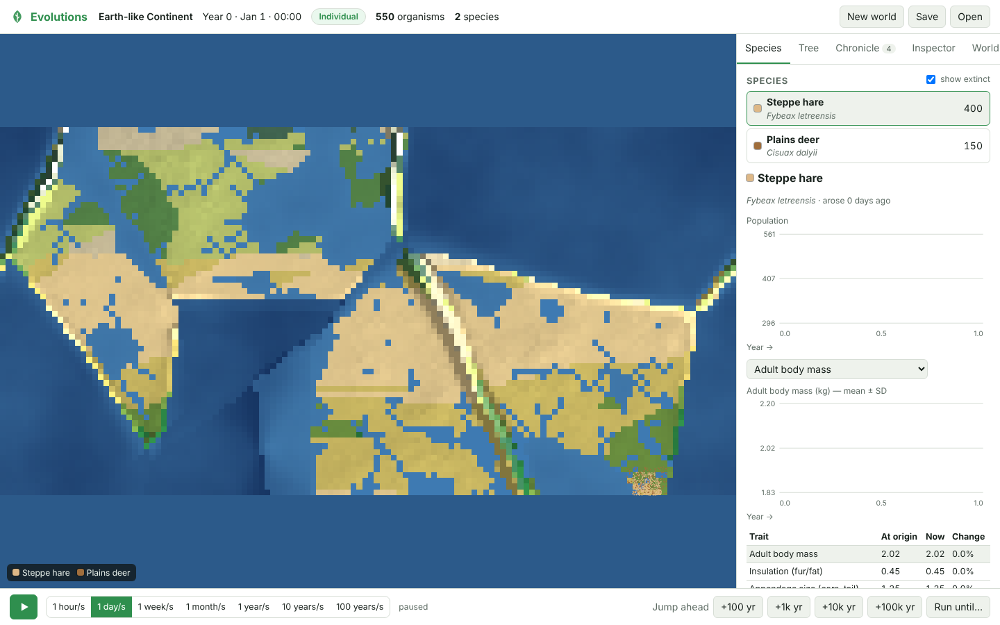

- **Top bar:**
  - the world name and the simulated date;
  - the mode badge (**Individual** or **Population**);
  - the number of living organisms and species;
  - **New world**, **Save** and **Open**.
- **Map:** terrain and biomes, coloured by type (deserts, grasslands, forests, tundra, ice) with relief shading. Lakes and rivers are blue. The world wraps east–west, like a globe.
  - Scroll to zoom and drag to pan.
  - The legend in the bottom-left corner names the species colours.
- **Side panel:** the **Species**, **Tree**, **Chronicle**, **Inspector** and **World** tabs.
- **Time bar:** play/pause, speed presets, the achieved speed, **Jump ahead** buttons and **Run until…**.

---

## 3. Watch individual animals

Press **▶** (or **Space**). In Individual mode every animal lives hour by hour: it forages, looks for water, rests in shade when hot, flees predators, hunts, courts, gives birth and nurses its young. Zoom in to see each animal as a dot in its species colour.

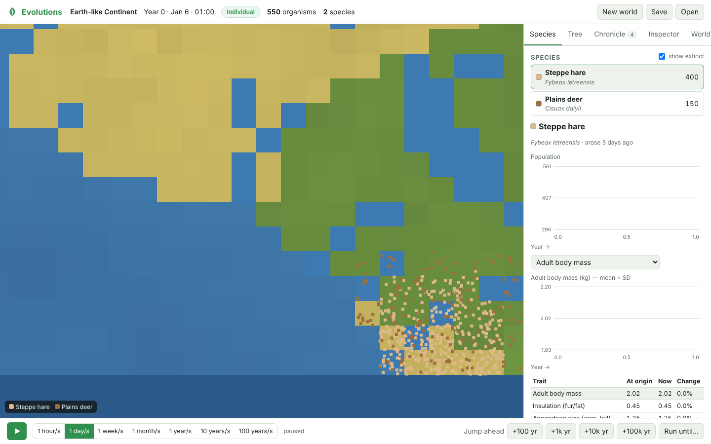

**Click an animal** to open the **Inspector**. A yellow ring marks it on the map, and the panel updates live as it lives its life.

The Inspector shows:

- **Identity:** species, sex, age and generation.
- **What it is doing now**, for example Resting, Foraging, Looking for water, Fleeing, Seeking a mate or Following mother.
- **Energy reserves and hydration:** when either runs out, the animal dies of starvation or dehydration.
- **Body:** current and adult mass, top speed, resting metabolism, and how well it digests plants and meat.
- **Family:** offspring, matings, new mutations it carries, and genetic heterozygosity.
- **Here:** the biome, the temperature now and on average, rainfall, and how much forage is left on its tile.
- **Phenotype:** all 21 heritable traits, as developed from its genes plus its environment.

Close it with **✕**.

---

## 4. Control time

| Control | What it does |
|---|---|
| **▶ / ❚❚** | Play or pause (**Space**). |
| **Speed presets** | **1 hour/s**, **1 day/s**, **1 week/s** and **1 month/s** suit watching animals. **1 year/s**, **10 years/s** and **100 years/s** suit watching evolution. |
| **≈ speed** | The speed actually achieved. Very large worlds may run slower than the preset. |
| **Jump ahead +100 / +1k / +10k / +100k yr** | Fast-forwards that many years as fast as possible. |
| **Run until…** | Fast-forwards until something happens (see [section 10](#10-run-until-something-happens)). |

During a jump, a progress card shows the year reached. **Stop here** ends the jump at the current year.

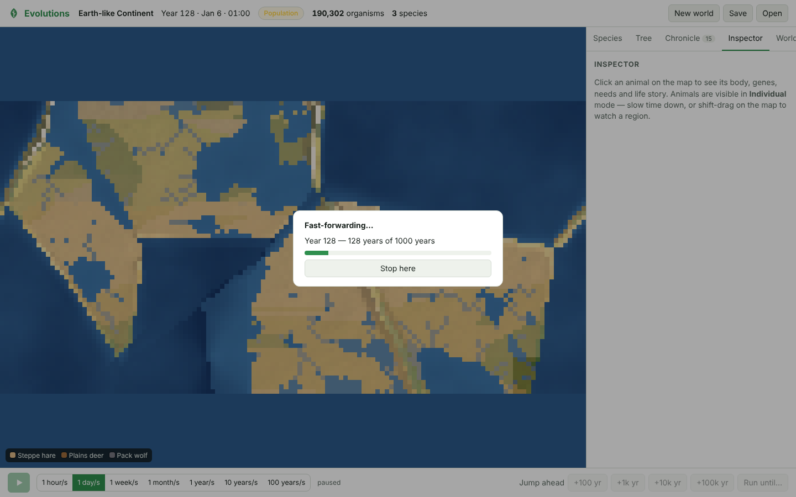

---

## 5. Individual and Population modes

Simulating every animal hour by hour is too slow for thousands of years, so Evolutions has two levels of detail. Both use the same biology.

| Mode | What is simulated | Used for |
|---|---|---|
| **Individual** | Every organism, one hour at a time. | Watching behaviour; short spans of time. |
| **Population** | Groups (demes) in each 8 × 8-tile patch, one year at a time. Each group tracks its age structure and the frequency of every gene variant, under selection, drift, mutation and migration. | Centuries to hundreds of thousands of years. |

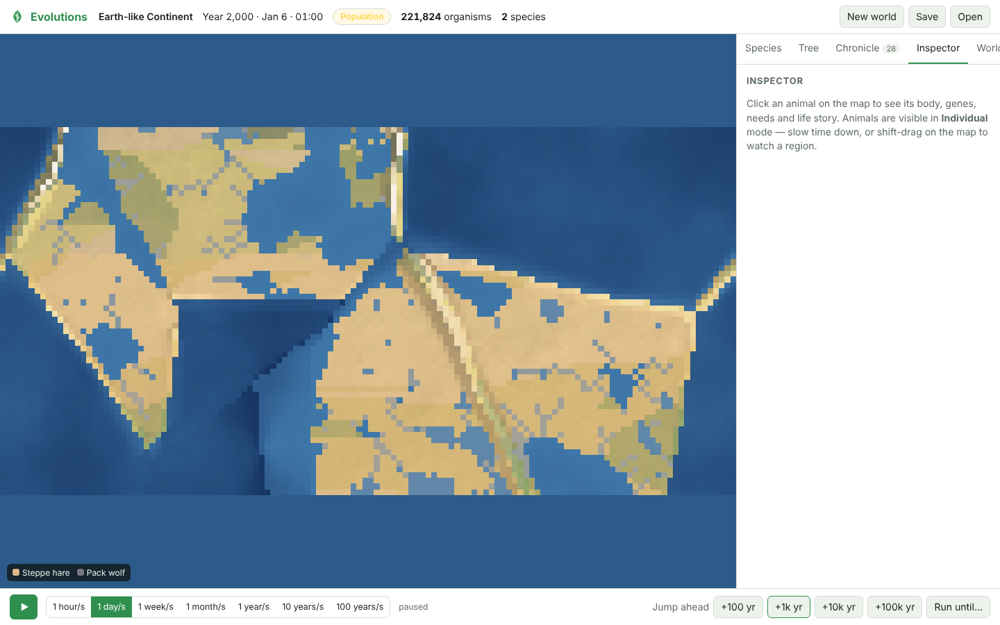

In Population mode the map shows species ranges as colour over the terrain. Each tile takes the colour of its most abundant species, more strongly where that species is denser.

**Choosing the mode.** In the **World** tab, **Simulation detail** has three settings:

- **Auto** (default) uses Individual mode up to about 1 week/s and switches to Population mode at higher speeds and for jumps. It also switches if the population grows too large to follow one by one (more than 25,000 animals).
- **Individual** or **Population** locks the mode.

---

## 6. Species: populations and traits over time

The **Species** tab lists every species. Living species come first, sorted by abundance; tick **show extinct** to include extinct ones (marked with † and the year they died out). Click a species to see its history.

- **Population chart:** abundance over time on a log scale. Hover over it to read exact values.
- **Trait chart:** pick any trait from the drop-down. The chart shows the species' mean (line) and spread (± one standard deviation, the shaded band) over time.
- **Trait table:** the main traits at the species' origin and now, with the percentage change. Increases are green and decreases red. Click a row to chart that trait.
- **Neutral genetic diversity:** heterozygosity at neutral marker genes. It falls in small or bottlenecked populations.

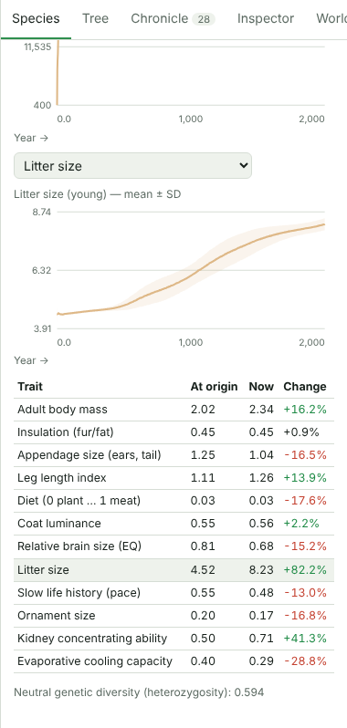

In this run, hares evolved larger litters (+70%), better water-conserving kidneys (+46%), longer legs and larger bodies. Nobody programmed those outcomes: they emerged from the hares' energy budget, predation by wolves, and the climate.

---

## 7. Tree of life

The **Tree** tab draws every lineage as a line from its origin to the present, or to its extinction (dashed, with †). When the simulation detects that two populations of a species can no longer interbreed successfully, a daughter species branches off its parent. The cause is recorded as either geographic separation (allopatric) or divergence without a barrier.

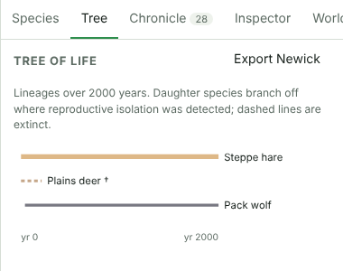

- Click a branch to open that species in the **Species** tab.
- **Export Newick** downloads the tree as a `.nwk` file for phylogenetics tools such as FigTree, iTOL or R/ape.

New species take time. They arise fastest in small, isolated populations, such as on islands (try **Archipelago** or **Island Dwarfism Lab** and jump 10,000+ years), and much more slowly in large connected ones, as in nature.

---

## 8. Chronicle

The **Chronicle** tab is the story of your world, newest first. Each entry has the year and, where relevant, the species colour (click it to open that species).

It records:

- **Adaptations:** a trait shifted by 3, 6, 9 … standard deviations since the species arose, for example *"litter size increased by 70%"*.
- **New species**, **extinctions** and **population crashes**.
- **World events:** founders released, mode switches, interventions, and climate recovering after an impact winter.

Use the filter chips (**All**, **New species**, **Extinctions**, **Adaptations**, **World**) to focus on one kind of event.

---

## 9. Map layers

In the **World** tab, **Map layer** switches what the map shows:

| Layer | Shows |
|---|---|
| **Terrain & biomes** | The default view: biomes, relief and water, plus individuals or species ranges. |
| **Temperature (today)** | Today's temperature from blue (cold) to red (hot). It changes with the seasons and with climate interventions. |
| **Rainfall** | Annual precipitation from brown (dry) to teal (wet). Look for rain shadows behind mountain ranges. |
| **Vegetation** | How much forage is left compared with what the land can grow. Grazing pressure shows up as browner areas. |
| **Population density** | Organisms per tile on a heat scale, for **all species** or one species picked in **Density of**. |

| | |
|---|---|
| 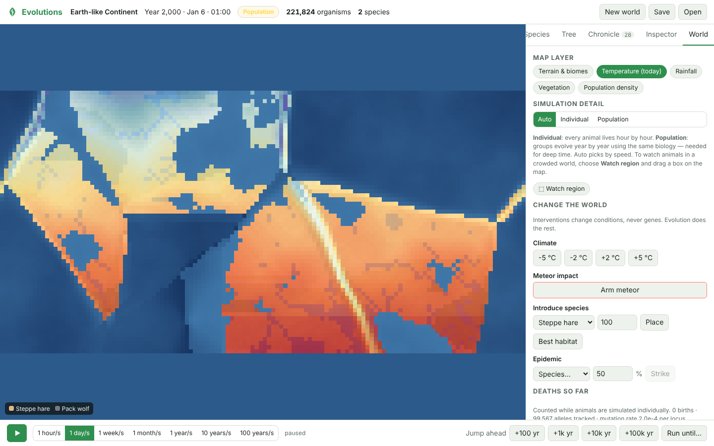 | 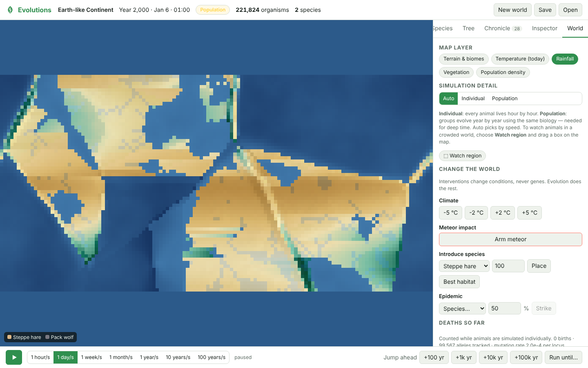 |
| 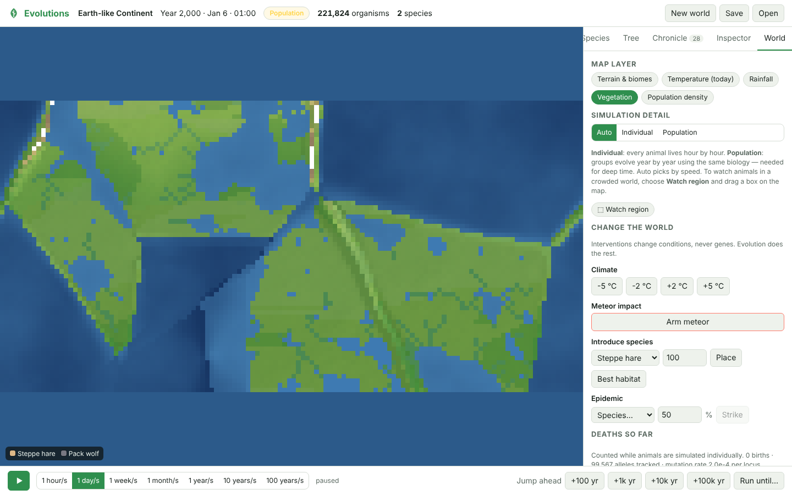 | 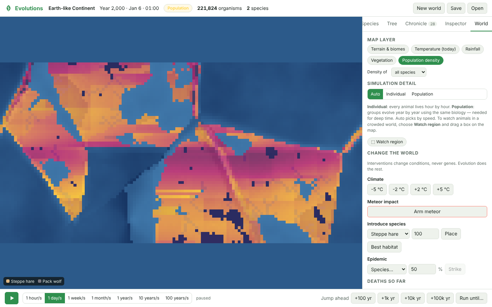 |

---

## 10. Run until something happens

**Run until…** fast-forwards until a condition is met, so you do not have to keep pressing Jump.

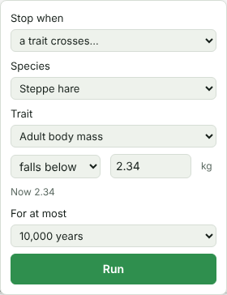

Stop when:

- **a new species arises**;
- **a species goes extinct**;
- **population crosses…** a threshold, above or below, for one species or all;
- **a trait crosses…** a threshold, for example when steppe hare adult body mass rises above 3 kg. The current value is shown for reference.

**For at most** caps the run at 100 to 100,000 years. If the condition is already true when you start, the app says so and runs the full length.

---

## 11. Watch a region in a crowded world

Once a world holds more than about 25,000 animals, they can't all be simulated one by one. You can still watch animals in any part of the world:

1. In the **World** tab, click **⬚ Watch region**, or hold **Shift** on the map.
2. Drag a box over the area you want to watch.

The animals in that box become individuals; the rest of the world waits as groups until you return to Population mode. A dashed outline marks the region, and the badge reads **Individual · region**.

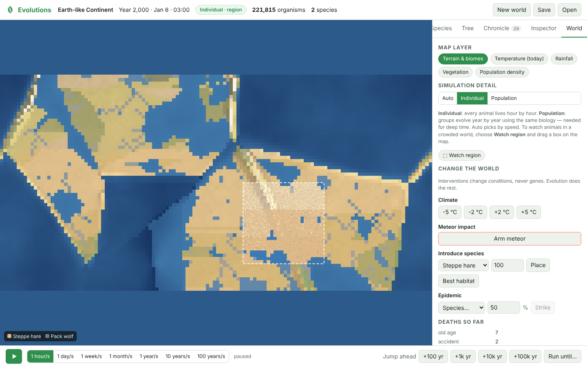

If the box holds too many animals, the app asks you to choose a smaller area.

---

## 12. Change the world (interventions)

Interventions change **conditions only, never genes**. Evolution does the rest. Each one is logged in the Chronicle.

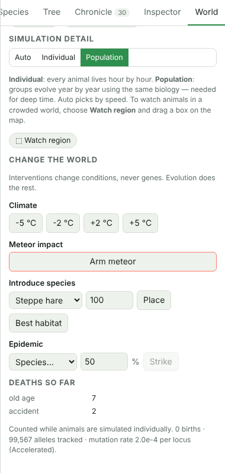

| Intervention | How to use it | Effect |
|---|---|---|
| **Climate** | Click **−5 °C**, **−2 °C**, **+2 °C** or **+5 °C**. | Shifts global temperature. Biomes, plant growth and heat or cold stress change; watch insulation, body size and ranges respond. The current offset is shown below the buttons. |
| **Meteor impact** | Click **Arm meteor**, then click the map. | Kills nearly everything within the blast radius, strips vegetation, and causes an impact winter (−4 °C for about 8 years). |
| **Introduce species** | Pick a species and a count, then **Place** (and click the map) or **Best habitat**. | Releases new founders. Good for invasive-species or predator-reintroduction experiments. |
| **Epidemic** | Pick a species and a mortality %, then **Strike**. | Kills that share of the species, creating a bottleneck. Watch genetic diversity drop. |

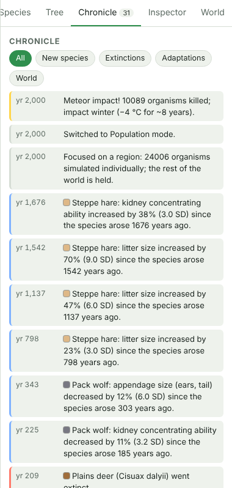

At the bottom of the **World** tab, **Deaths so far** breaks down causes of death recorded while animals are simulated individually: starvation, dehydration, predation, old age, heat stroke, cold, accidents, catastrophes and non-viable embryos (failed hybrids). It also shows births, the number of gene variants tracked and the mutation rate in use.

---

## 13. Save, open and resume

- **Save** (top bar) downloads the whole world as an `.evo` file: terrain, every genome, populations, species, history and chronicle.
- **Open** (top bar, or **Open a saved world…** in the Create dialog) loads an `.evo` file and continues exactly where it left off. The same seed and save always continue identically.
- **Autosave:** the app also keeps your latest world in the browser. It saves when the world is created, every minute while it runs, and after each jump. When you come back, the Create dialog offers **Continue where you left off?** with the template, seed, year and save time; click **Resume**.

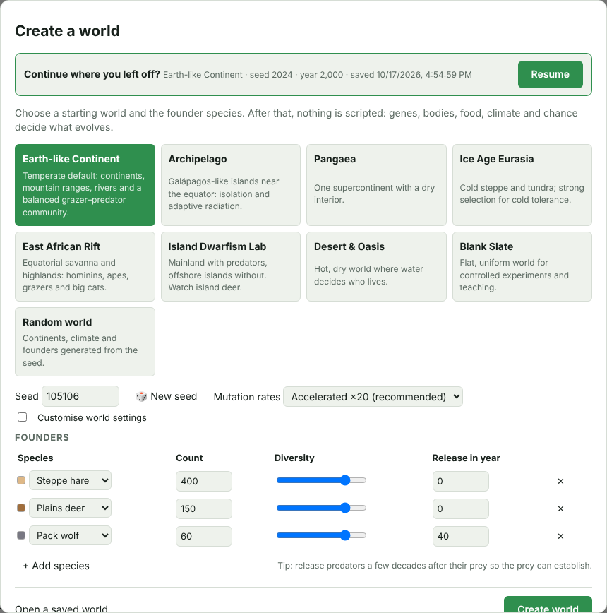

Autosave is per browser and is lost if you clear site data, so use **Save** for worlds you want to keep or share.

---

## 14. Keyboard and mouse reference

| Input | Action |
|---|---|
| **Space** | Play / pause. |
| **Esc** | Cancel the armed tool (meteor, place species, watch region). |
| **Scroll** on the map | Zoom in or out at the cursor. |
| **Drag** on the map | Pan. The world wraps east–west. |
| **Click** an animal | Open it in the Inspector (Individual mode). |
| **Shift + drag** on the map | Watch that region individually. |
| **Hover** a chart | Read exact values. |

---

## 15. Tips for good experiments

- **Compare like with like:** use the same seed and change one thing, such as the climate, a founder count or mutation rates. Then compare the Species charts.
- **See natural selection:** the **Ice Age Eurasia** template with 1,000–5,000 years of jumps shows insulation rising. The **Desert & Oasis** template shows kidneys and heat tolerance improving.
- **See a bottleneck:** strike a species with a 90% epidemic, then watch its neutral genetic diversity in the Species tab.
- **See predator–prey dynamics:** in the Earth-like template, watch the wolf and hare population charts after the wolves arrive in year 40. Abundant hares can sustain enough wolves to wipe out the scarcer deer (apparent competition).
- **See speciation:** use small isolated populations (**Archipelago**, **Island Dwarfism Lab**) and **Run until… a new species arises** with a 100,000-year cap.
- **Be patient with deep time:** Population mode runs at roughly 30–70 simulated years per second, depending on world size. 100,000 years takes a few minutes.
- **Strict vs Accelerated:** with **Strict** mutation rates, adaptation relies mostly on the variation founders already carry. That is realistic for short spans, but expect little change in new traits.

For how the biology works under the hood, see the [Technical Requirements](TRD.md). For the architecture, see the [System Design](SYSTEM_DESIGN.md).
